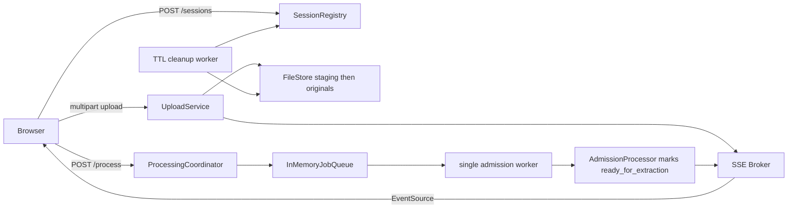
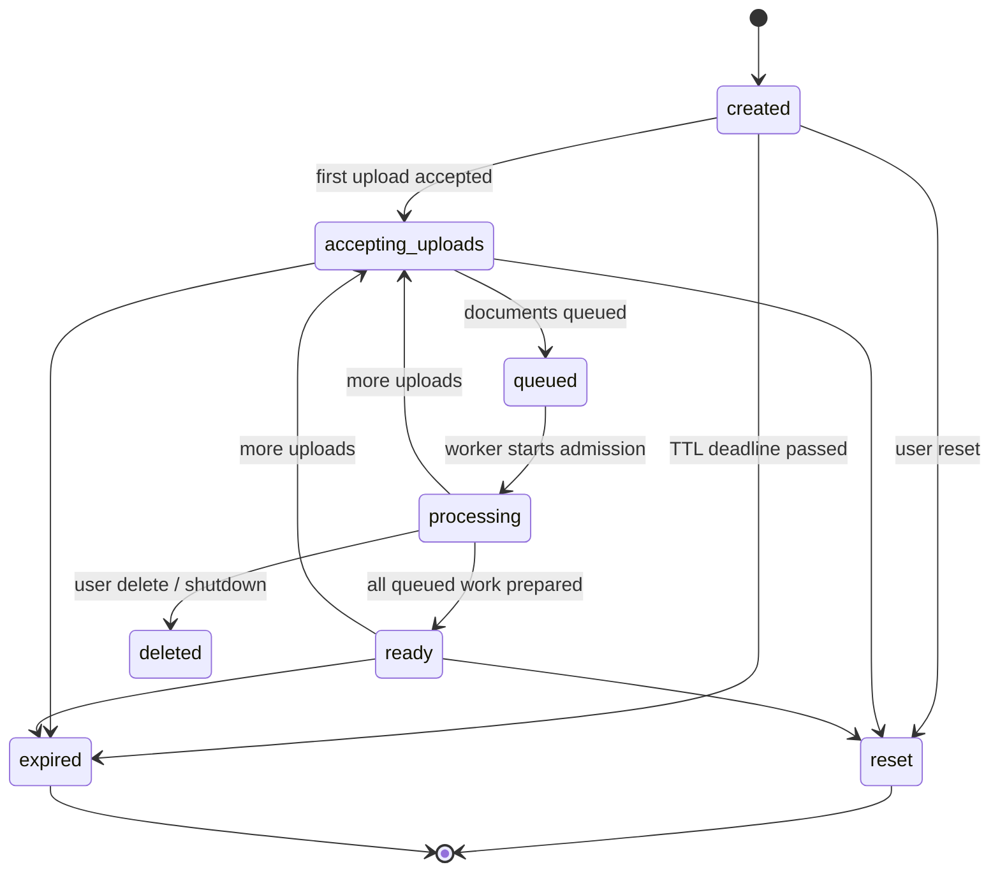
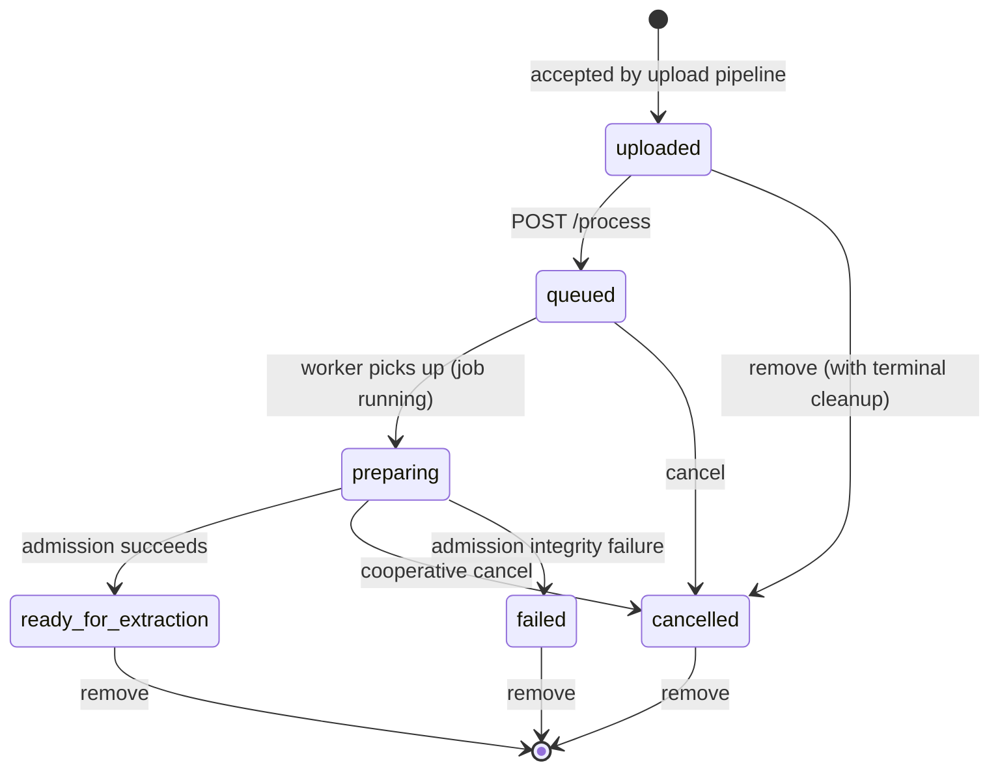
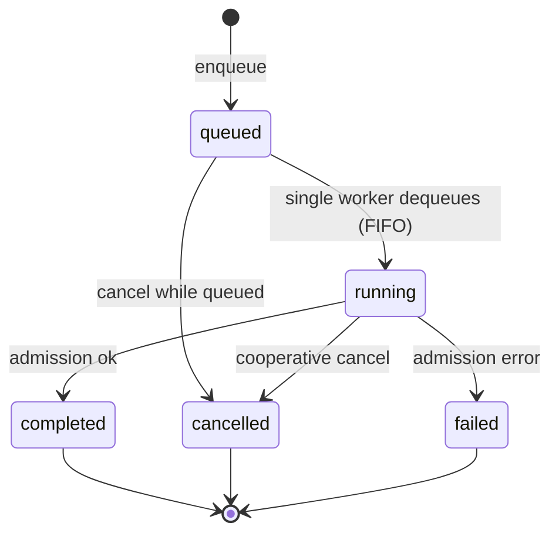
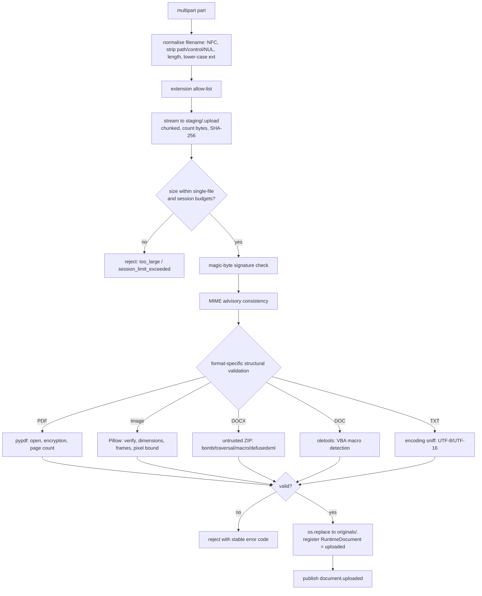
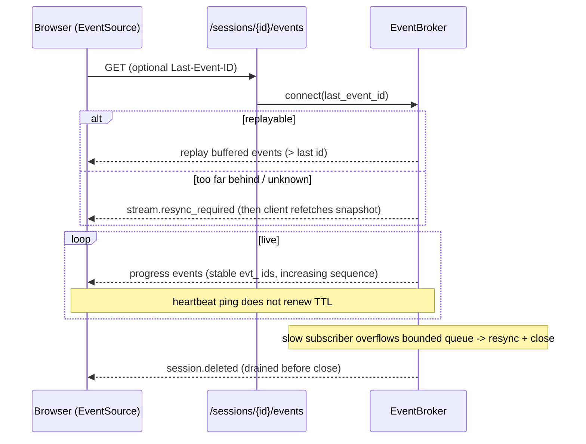
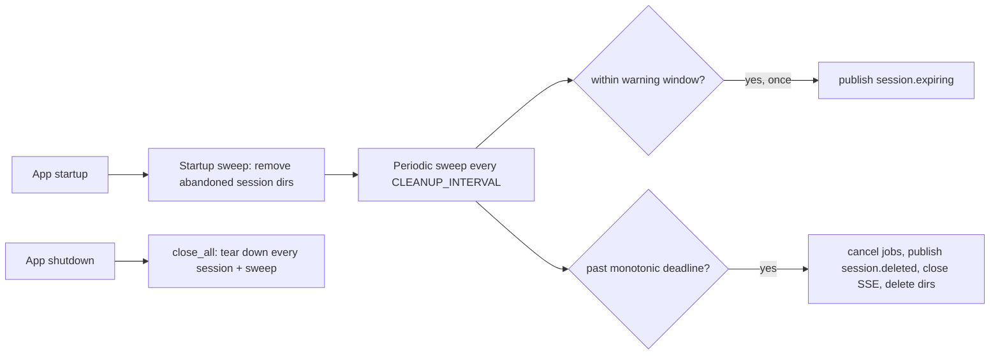

# Phase 1 - Runtime sessions, uploads and processing queue

This document describes the Phase 1 architecture: a temporary, browser-scoped
session workspace, a defensive multi-document upload pipeline, an in-memory
processing queue with a single admission worker, live progress over Server-Sent
Events (SSE), and TTL/shutdown cleanup.

**Scope boundary.** Phase 1 performs **no** extraction of any kind: no
canonicalisation, PDF rendering, native-text reading, OCR, layout analysis, or
LLM calls. `pypdf` and `Pillow` are used *only* for structural upload validation
(open/encryption/page-count; format/integrity/dimensions/frames). The system is
single-process and runs exactly one queue admission worker. The furthest a
document advances is `ready_for_extraction`, which explicitly claims no results.

## Component overview

```text
backend/app/
├── storage/       # paths (containment-checked) + chunked file store
├── sessions/      # RuntimeSession/RuntimeDocument, async registry, snapshot
├── uploads/       # filename, signatures, MIME policy, format + word validators, service
├── processing/    # queue (Protocol + in-memory), cancellation, admission, coordinator
├── progress/      # per-session SSE broker (replay/resync) + stream service
├── cleanup/       # TTL sweep + startup/shutdown cleanup worker
├── contracts/     # identifiers, sessions, documents, uploads, jobs, progress, processing
└── api/v1/        # sessions, documents, jobs endpoints
```

All runtime state (sessions, documents, jobs, brokers, queue) lives in memory on
`app.state`. Nothing is persisted; a server restart or browser refresh starts
fresh, and the startup sweep removes any directory left by a previous process.

## Key flow



## Session state machine

Sessions are created eagerly by the browser on load. The status is derived from
document/job counts; TTL is an **inactivity** timeout.



**Inactivity TTL.** Only user-initiated mutations (create, upload, process,
cancel, remove) refresh the deadline. Read-only reads (`GET` snapshot, list/get
document) and SSE (re)connections deliberately **do not** extend the TTL:
otherwise an open tab that polls the snapshot on every progress event — including
the expiry warning itself — could never expire, defeating both the cleanup
guarantee and the expiry UX. See ADR 0004.

## Document state machine



Progress is capped at **5%** for `preparing`/`ready_for_extraction`; the snapshot
carries `result_available: false` and `extraction_performed: false` so the UI can
never imply results exist.

## Job state machine



Queue positions are 1-based and recomputed dynamically from the protected ordered
pending index; a job is never enqueued twice.

## Upload pipeline

Uploads are streamed and validated defensively, in multipart order, with
session-limit decisions made as each file is admitted. No file contents are
trusted from the client-declared type alone.



The original filename is metadata only; on disk, files are named by opaque
`doc_` identifiers under a containment-checked per-session directory tree. Failed
or partial files are cleaned from staging with bounded-retry deletion (Windows
lock tolerance). See ADR 0005.

## SSE broker, replay and resync

Each session owns one `EventBroker` with a monotonic sequence, a bounded replay
deque, and bounded per-subscriber queues.



Connections are capped per session (`MAX_SSE_CONNECTIONS_PER_SESSION`). On client
disconnect, the stream generator cancels its helper tasks (no orphan tasks) and
disconnects the subscriber. See ADR 0007.

## TTL and cleanup



The monotonic deadline (not wall-clock) governs expiry, so clock changes cannot
prematurely expire or indefinitely extend a session.

## Frontend

The browser creates exactly one session per page load via a module-scoped
bootstrap promise (React Strict Mode safe). State is memory-only — no
`localStorage`, `sessionStorage`, IndexedDB, or cookies. TanStack Query owns
server state; Zustand holds only ephemeral UI state.

- `useSessionEvents` opens a native `EventSource`, validates each event with the
  generated `ProgressEvent` Zod schema, coalesces refetches, handles
  `stream.resync_required` (snapshot refetch) and `session.deleted` (close), and
  shows a reconnecting indicator.
- `UploadPanel` runs preliminary client checks, uploads via `FormData` (no fake
  percentages), and reports accepted/rejected files per batch.
- `QueueDashboard` / `DocumentCard` render counts, dynamic queue positions, and
  Process/Cancel/Remove actions; wording never implies extraction results.
- Reset (with confirmation) and expiration are explicit, honest states. On
  `pagehide` a best-effort `DELETE` with `keepalive` releases the session.

## Health

Readiness (`GET /health/ready`) adds required Phase 1 checks — session workspace
writable, admission coordinator running, cleanup worker running, queue accepting
work — returning 503 on any required failure. Future capabilities (LibreOffice,
PaddleOCR, handwriting classifier, vision provider) remain optional
`not_configured` checks.

## Testing note: admission hold

`QUEUE_ADMISSION_TEST_DELAY_SECONDS` (default `0`, **must be 0 in production**)
makes the non-extractive admission step sleep cooperatively — honouring
cancellation — so end-to-end tests can observe the queued/preparing states and
exercise cancellation deterministically. It never performs any work.
