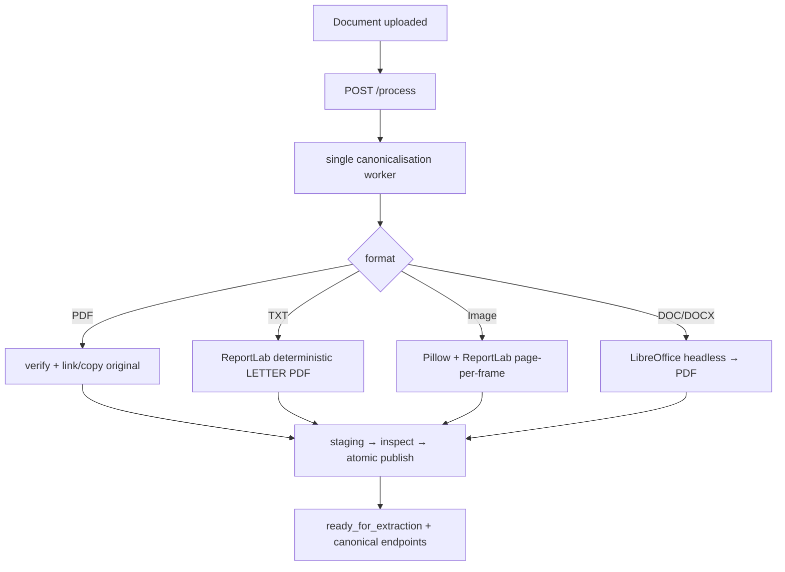

# Phase 2 - Canonical documents, coordinates and viewer

Phase 2 turns accepted uploads into **canonical PDFs** with deterministic
metadata, serves them over HTTP (including byte ranges), and adds a PDF.js
viewer with a normalised top-left coordinate system for synthetic overlay proof.

**Scope boundary.** Phase 2 performs **canonicalisation only** — no native-text
trust, OCR, layout analysis, handwriting routing, or vision LLM calls. Documents
advance to `ready_for_extraction` with `canonical_view_available: true` and
bounded progress (≤ 15%); `result_available` and `extraction_performed` remain
false.

## Component overview

```text
backend/app/
├── geometry/      # normalised point/box/polygon contracts + rotation helpers
├── canonical/     # TXT/image/PDF/Word producers, inspection, LibreOffice, processor
├── api/v1/        # canonical PDF, metadata, overlay-proof endpoints
└── health/        # readiness adds LibreOffice + ReportLab + canonical storage

frontend/src/features/viewer/   # PDF.js viewer, scale controls, overlay proof
```

Phase 1 packages (`storage/`, `sessions/`, `uploads/`, `processing/`, `progress/`,
`cleanup/`) are extended: the coordinator now runs a **canonicalisation worker**
(not admission-only), and `RuntimeDocument` carries canonical status and page
metadata.

## Canonicalisation flow



Producers write to per-job staging, inspect with `pypdf` (geometry only — no text
extraction), hash, and `os.replace` into `canonical/<doc_id>.pdf`. Original PDFs
are published byte-identically when valid.

## Coordinate system

All overlay geometry uses **normalised page space**: origin top-left, x
left→right, y top→down, values in `[0, 1]`. Intrinsic PDF rotation is recorded
in page metadata; viewer rotation is applied client-side. See ADR 0010.

Phase 2 ships a **synthetic overlay proof** (`GET .../canonical/overlay-proof`)
with fixed alignment geometry on every page — not extracted content.

## Canonical delivery

- `GET .../canonical` — inline PDF with `Accept-Ranges: bytes`, `Cache-Control: no-store`.
- `GET .../canonical/metadata` — page dimensions, rotation, source type, SHA-256.
- `GET .../canonical/overlay-proof` — synthetic alignment overlays.

Documents not yet canonicalised return **409** `canonical_document_not_ready`.

## Health

Readiness adds required checks: **LibreOffice** (external runtime), **ReportLab**
(with Helvetica), and **canonical storage** writable. OCR, handwriting classifier,
and vision provider remain optional `not_configured`.

## Frontend

PDF.js (`pdfjs-dist`) renders the canonical PDF in-session. Scale controls honour
configured min/max/step. Overlays consume the overlay-proof endpoint and map
normalised boxes into the viewer canvas. See ADR 0011.

## Testing note

LibreOffice-dependent tests skip when the runtime is unavailable. CI installs
`libreoffice-writer` before backend tests. Residual-data guard also fails on
`.pdf.part` files or non-empty `staging/libreoffice/` trees.
