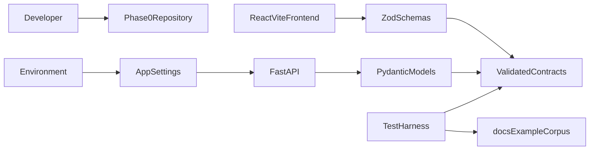
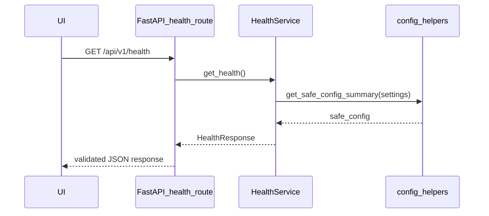
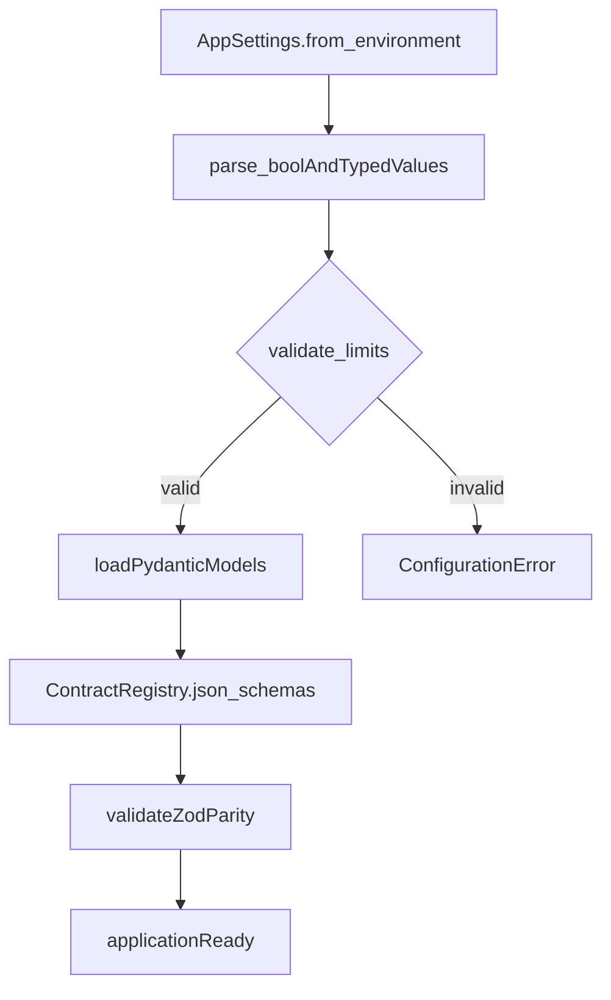
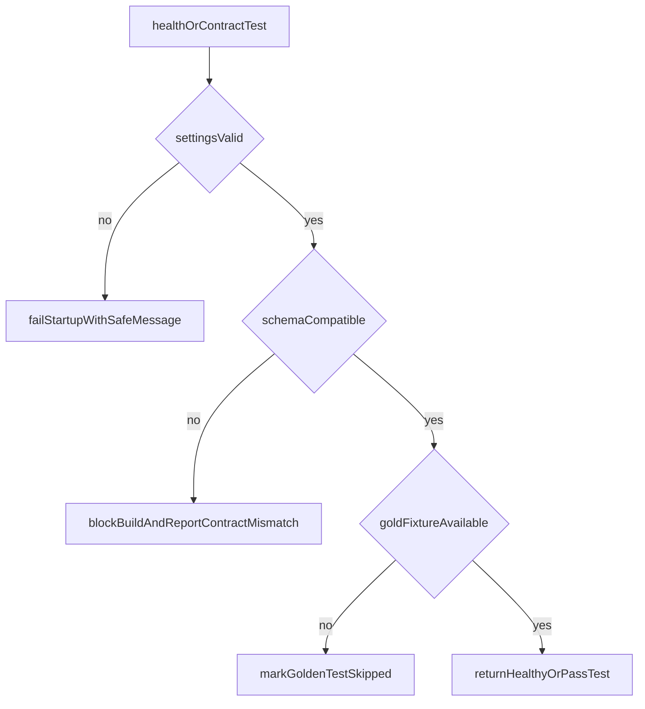

# 00. Repository and Contracts

| Field | Value |
|-------|-------|
| Spec | §6–7, §14, Appendix C–D / Phase 0 |
| Service(s) | ContractRegistry, HealthService (proposed) |
| Upstream | None |
| Downstream | 01 Session and Workspace; all later modules |
| Exit gate | Repository can start the API, validate shared contracts, report health, and run unit/integration/golden test harnesses without OCR or LLM work. |
| Status | design |
| Contracts | [`docs/contracts/`](../contracts/README.md) (all entities); [`enums.md`](../contracts/enums.md); [`error-codes.md`](../contracts/error-codes.md); [`health-response.md`](../contracts/entities/health-response.md); [`app-settings.md`](../contracts/entities/app-settings.md) |

## 1. Purpose
Establish the monorepo, canonical Pydantic and TypeScript/Zod contracts, configuration defaults, health check, and test layers that let later modules exchange validated session-only evidence objects without introducing OCR, LLM extraction, a database, or persistent case storage.

## 2. Responsibilities
- Own the Phase 0 repository layout from Appendix C and shared backend/frontend schemas derived from §7.
- Define configuration parsing and the Appendix D defaults, including safe limits and LLM semantic extraction disabled by default.
- Provide a versioned FastAPI health endpoint and a contract-validation test harness.
- Keep Pydantic models canonical; frontend Zod schemas validate API responses derived from the same JSON Schema.
- Do not accept files, create sessions, perform OCR/LLM work, persist case data, or implement later workflow services.

## 3. Inputs and outputs
| Inputs | Source | Validation |
|---|---|---|
| Environment variables | process environment / `.env` | `AppSettings` bounds and typed parsing |
| API request/response payloads | later API routes | Pydantic and Zod schemas |
| Reference fixtures | `docs/example/`, `fixtures/` | test-only; never copied to logs |

| Outputs | Consumer | Contract |
|---|---|---|
| `CaseSession`, `Document`, `DocumentPage`, `SourceToken`, `SourceSpan`, `Fact`, `Issue` models | all services | validated Pydantic JSON |
| TypeScript/Zod API types | React features/viewer | JSON-compatible response validation |
| `/api/v1/health` | UI, tests, deployment checks | status/version/config-safe response |

| Side effect | Constraint |
|---|---|
| Creates project source/test directories and test artifacts | no case documents or database files |
| Reads environment configuration | never return secrets or document text |

## 4. Functional requirements
Phase 0 realizes architectural contracts rather than a dedicated §8 FR set.

| Mapping | Acceptance note |
|---|---|
| §6.2 stack | React/Vite/TypeScript + Zustand/Zod; FastAPI + Pydantic; no dependency on paid DocAI. |
| §7.1 system of record | Evidence objects, not raw model output, are the canonical contract. |
| §7.2 core entities | Models cover `CaseSession`, `Document`, `DocumentPage`, `SourceToken`, `SourceSpan`, `Fact`, `Issue`, `TimelineEvent`, `BillingEntry`, `DraftSection`, and `UserDecision`. |
| §7.3 coordinates | Token/span polygons use normalized top-left page coordinates in `[0, 1]`. |
| §14.1 API principles | Routes are under `/api/v1`, responses are Pydantic-validated, opaque IDs are used, and local paths are excluded. |
| Appendix D | Defaults exactly start with the documented limits and disabled semantic extraction. |

## 5. Proposed design (classes, methods, functions)
All interfaces below are **proposed design** until implemented.

### 5.1 Types / models
- `AppSettings`: `session_ttl_minutes`, upload/page limits, OCR render/retry DPI, feature flags, and logging policy.
- `CaseSession`, `Document`, `DocumentPage`, `SourceToken`, `SourceSpan`, `Fact`, `Issue`, `TimelineEvent`, `BillingEntry`, `DraftSection`, `UserDecision`.
- Shared enums: `SessionStatus`, `DocumentStatus`, `ExtractionMethod`, `FactStatus`, `IssueSeverity`, `ReviewState`.
- Frontend mirrors live in `frontend/src/schemas/`; **hand-maintain** Zod against [`docs/contracts/`](../contracts/README.md) until CI generation exists. Intended path: Markdown contracts → Pydantic (canonical) → Zod mirrors (see contracts README).

### 5.2 Service API (method list with signatures)
| Proposed method | Called by | Calls | FR / source mapping | Failure modes |
|---|---|---|---|---|
| `HealthService.get_health(self) -> HealthResponse` | `GET /health` | `get_safe_config_summary` | §14.1 | dependency/version metadata unavailable → degraded status |
| `ContractRegistry.json_schemas(self) -> dict[str, dict[str, object]]` | contract tests/build step | model schema exporters | §7.2, §14.1 | incompatible schema change |
| `AppSettings.from_environment(cls) -> AppSettings` | app startup | `parse_bool`, `validate_limits` | Appendix D | invalid/out-of-range environment value |
| `TestHarness.load_gold_manifest(self) -> GoldManifest` | golden scaffold / Phase 0 | `discover_fixture_metadata` | Appendix G | controlled corpus unavailable → explicit skipped test. Full Phase 10 runner/metrics live in [module 12](./12-evaluation-demonstration.md). |

### 5.3 Helpers / pure functions
```python
def normalize_polygon(
    points: list[tuple[float, float]], page_width: float, page_height: float
) -> list[tuple[float, float]]: ...

def validate_normalized_polygon(points: list[tuple[float, float]]) -> None: ...

def parse_bool(value: str) -> bool: ...

def get_safe_config_summary(settings: AppSettings) -> dict[str, int | bool]: ...
```

### 5.4 API endpoints (if any)
- **Proposed:** `GET /api/v1/health` returns API status, version, and non-sensitive configuration capabilities. It does not report filesystem paths, secrets, uploaded content, or session data.

## 6. Detailed flows
### 6.1 Context diagram (Mermaid)


### 6.2 End-to-end sequence (Mermaid sequenceDiagram)


### 6.3 Internal algorithm (Mermaid)


### 6.4 Error / edge-case flow (Mermaid)


## 7. Data contracts

**Contracts SoT:** Field-level shapes, enums, and taxonomies live in [`docs/contracts/`](../contracts/README.md) (`contracts_version` 0.1). Do not redefine entity fields in this module doc. **If this prose conflicts with `docs/contracts/`, contracts win.**

| Contract | Link |
|----------|------|
| Index / rules | [docs/contracts/README.md](../contracts/README.md) |
| Enums | [docs/contracts/enums.md](../contracts/enums.md) |
| AppSettings | [entities/app-settings.md](../contracts/entities/app-settings.md) |
| HealthResponse | [entities/health-response.md](../contracts/entities/health-response.md) |
| CaseSession / Document / pages / spans / Fact / Issue / … | [docs/contracts/entities/](../contracts/entities/) |
| Fact / issue taxonomies | [fact-types.md](../contracts/fact-types.md), [issue-types.md](../contracts/issue-types.md) |
| API error codes | [error-codes.md](../contracts/error-codes.md) |

`AppSettings` defaults match Appendix D (see app-settings entity). Environment overrides remain validated and never appear with secrets in health output.

## 8. UI touchpoints
Backend foundation plus the frontend app shell. A future status banner may consume `/api/v1/health`; no case-workspace UI is delivered here.

## 9. Testing and exit gate
- Unit: settings defaults/bounds, enum/model validation, normalized coordinate rejection, safe health payload.
- Contract: Pydantic JSON Schema and Zod response fixture parity; opaque IDs and no local-path fields.
- Integration: boot FastAPI and call `GET /api/v1/health`.
- Golden harness: register `docs/example/` Amini corpus metadata without logging or processing it. Phase 0 owns scaffold only; the Phase 10 gold runner, metrics, and demo packet are owned by [module 12](./12-evaluation-demonstration.md).
- Exit gate: repository layout, contracts, default config, health check, and unit/integration/golden test scaffolding pass with OCR and LLM services absent.

## 10. Open questions / non-goals
- Non-goal: implementing OCR, document parsing, file upload, session lifecycle, database persistence, queues, authentication, or LLM calls.
- **Resolved (contracts Pass 1 + SoT tighten):** Frontend Zod schemas are **hand-maintained mirrors** of [`docs/contracts/`](../contracts/README.md) until code/CI generation exists (Markdown → Pydantic → Zod).
- Decide the release/version source exposed by the health endpoint (`app_version` optional on HealthResponse).
