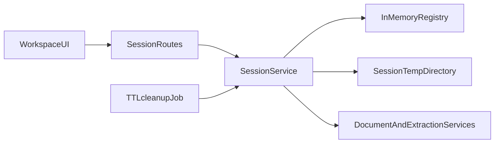
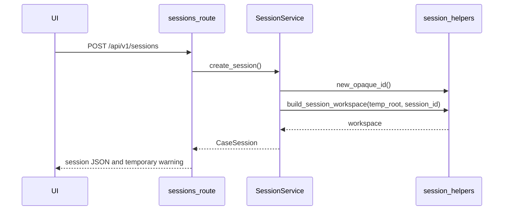
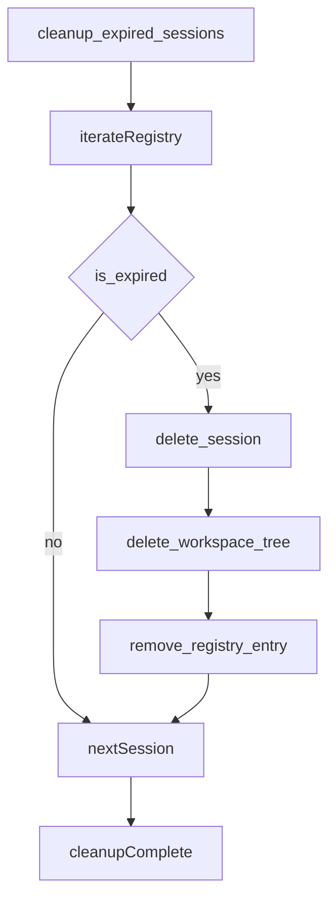
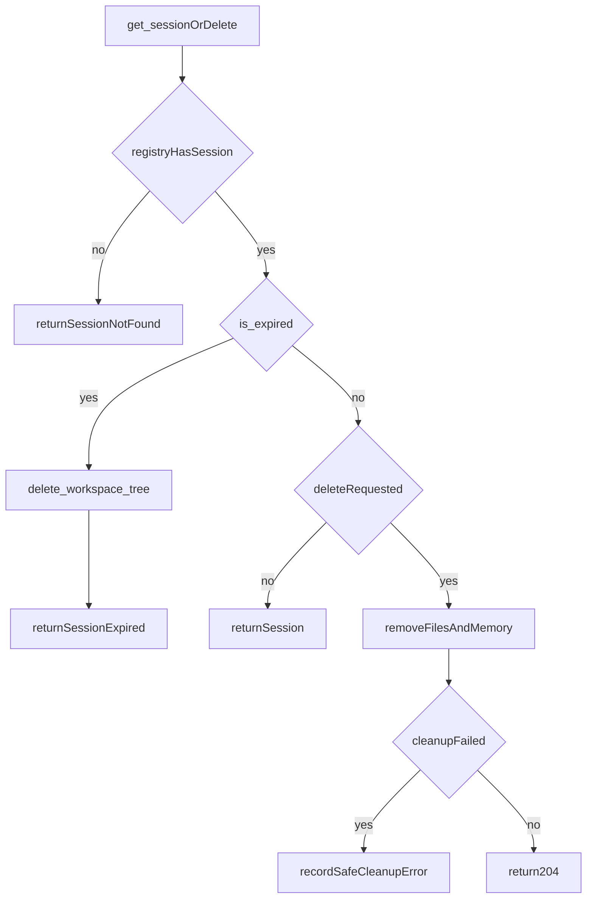

# 01. Session and Workspace

| Field | Value |
|-------|-------|
| Spec | §8.1 / Phase 1 |
| Service(s) | SessionService |
| Upstream | 00 Repository and Contracts |
| Downstream | 02 Upload, Validation, Normalization; all session-scoped modules |
| Exit gate | A user can start, reset, and expire a case without any residual file remaining in the configured temporary directory. |
| Status | design |
| Contracts | [`case-session.md`](../contracts/entities/case-session.md); [`SessionStatus`](../contracts/enums.md); session codes in [`error-codes.md`](../contracts/error-codes.md); [`app-settings.md`](../contracts/entities/app-settings.md) (TTL) |

## 1. Purpose
Create and destroy an isolated, temporary case workspace. The module holds active state in memory, creates an opaque session directory, applies the configured TTL, and makes reset/delete/expiry reliably remove all session data.

## 2. Responsibilities
- Create opaque session IDs, expiration timestamps, in-memory `CaseSession` objects, and private temporary directories.
- Delete state and files immediately for reset/delete and eventually for inactivity/failed-job cleanup.
- Expose session status/progress channel metadata and the browser-facing temporary-session warning.
- Ensure paths are server-derived and never expose local paths in API responses.
- Do not accept documents, retain cases after expiry, provide accounts/authentication, or persist data in a database.

## 3. Inputs and outputs
| Inputs | Source | Validation |
|---|---|---|
| Create request | UI | no user-chosen directory or ID |
| `AppSettings.session_ttl_minutes` | Phase 0 config | positive bounded value; default 120 |
| session ID | route/path | opaque ID lookup only |

| Outputs | Consumer | Contract |
|---|---|---|
| `CaseSession` | UI and later services | opaque ID, timestamps, status, settings |
| session workspace | document/extraction services | server-only temp path |
| progress channel metadata | UI polling/SSE | session ID and current status |

| Side effect | Constraint |
|---|---|
| creates `temp_root/<opaque-session-id>/` | session-only; restrictive server ownership |
| deletes files and in-memory registry entries | execute in `finally` cleanup paths |

## 4. Functional requirements
| FR | Acceptance note |
|---|---|
| FR-SES-01 | `create_session` emits an unpredictable opaque ID and `expires_at` from the configured TTL. |
| FR-SES-02 | Registry is process memory; every workspace is under its session-specific temp directory. |
| FR-SES-03 | Reset and DELETE remove registry state and all directory contents immediately; repeat deletion is safe. |
| FR-SES-04 | TTL sweeps inactive sessions and cleans failed-job sessions even if a worker raised. |
| FR-SES-05 | Create response/UI displays that refresh/loss of the temporary session may require starting over. |

## 5. Proposed design (classes, methods, functions)
All interfaces below are **proposed design** until implemented.

### 5.1 Types / models
- `CaseSession` — field shapes in [`case-session.md`](../contracts/entities/case-session.md).
- `SessionStatus` — canonical workflow states in [`enums.md`](../contracts/enums.md) (`created`, `ingesting`, `processing`, `reviewing`, `draftable`, `draft_review`, `exportable`, `expired`, `failed`, `deleted`). Do not use obsolete alias `active`.
- `SessionWorkspace`: server-only `Path`, with subdirectories `uploads/`, `derived/`, `thumbnails/`, and `work/` (never in API JSON).
- Domain errors map to [`error-codes.md`](../contracts/error-codes.md): `session_not_found`, `session_expired`, `session_cleanup_failed`, `session_limit_exceeded`.

### 5.2 Service API (method list with signatures)
| Proposed method | Called by | Calls | FR mapping | Failure modes |
|---|---|---|---|---|
| `create_session(self) -> CaseSession` | POST route | `new_opaque_id`, `create_session_workspace` | SES-01, SES-02, SES-05 | temp root unavailable |
| `get_session(self, session_id: str, *, touch: bool = True) -> CaseSession` | all scoped routes | `assert_not_expired` | SES-02, SES-04 | unknown/expired session |
| `reset_session(self, session_id: str) -> None` | reset action | `delete_workspace_tree`, `create_session` | SES-03 | delete failure is surfaced and retried |
| `delete_session(self, session_id: str) -> None` | DELETE route | `delete_workspace_tree`, `remove_registry_entry` | SES-03 | cleanup error; never leave active registry entry |
| `cleanup_expired_sessions(self, now: datetime) -> list[str]` | periodic/startup-finally hook | `is_expired`, `delete_session` | SES-04 | individual failure recorded then remaining sessions continue |
| `mark_job_finished(self, session_id: str, *, failed: bool) -> None` | processing orchestration | `touch_session` | SES-04 | session expired during job |

### 5.3 Helpers / pure functions
```python
def new_opaque_id(prefix: str = "ses") -> str: ...
def build_session_workspace(temp_root: Path, session_id: str) -> Path: ...
def is_expired(session: CaseSession, now: datetime) -> bool: ...
def delete_workspace_tree(workspace: Path, temp_root: Path) -> None: ...
def ensure_descendant(path: Path, root: Path) -> None: ...
```

### 5.4 API endpoints (if any)
- **Proposed:** `POST /api/v1/sessions` → `CaseSession` plus temporary-session warning.
- **Proposed:** `DELETE /api/v1/sessions/{session_id}` → `204 No Content`; unknown/deleted sessions are safely idempotent.
- **Proposed UI reset:** use DELETE then POST, rather than retaining old files or IDs.

## 6. Detailed flows
### 6.1 Context diagram (Mermaid)


### 6.2 End-to-end sequence (Mermaid sequenceDiagram)


### 6.3 Internal algorithm (Mermaid)


### 6.4 Error / edge-case flow (Mermaid)


## 7. Data contracts

**Contracts SoT:** [`docs/contracts/`](../contracts/README.md). **If this prose conflicts with `docs/contracts/`, contracts win.**

| Contract | Link |
|----------|------|
| CaseSession | [entities/case-session.md](../contracts/entities/case-session.md) |
| SessionStatus | [enums.md](../contracts/enums.md) |
| Session error codes | [error-codes.md](../contracts/error-codes.md) |
| AppSettings (TTL / temp root) | [entities/app-settings.md](../contracts/entities/app-settings.md) |

Illustrative JSON (fields from contracts):

```json
{
  "id": "ses_01JQ9M7E4H8Q",
  "created_at": "2026-07-18T12:00:00Z",
  "expires_at": "2026-07-18T14:00:00Z",
  "last_activity_at": "2026-07-18T12:00:00Z",
  "status": "created",
  "settings": {"ocr_render_dpi": 200},
  "warning": "This is a temporary prototype session. Refreshing or losing it may require starting over."
}
```

The server-only `SessionWorkspace.path` is deliberately absent from JSON.

## 8. UI touchpoints
- New-case entry creates a session and displays the temporary-session warning.
- Workspace header shows session status/expiry and supports Reset Case.
- Expired-session state offers Start a new case; it must not imply recovery of deleted data.

## 9. Testing and exit gate
- Unit: opaque ID format/uniqueness, TTL boundary, path-containment checks, idempotent delete, failed-job cleanup.
- Integration: POST creates one workspace; DELETE removes it and registry data; reset receives a new session with no old files.
- Failure test: force a job error, then run cleanup and assert no session directory remains.
- Exit gate: start, reset, delete, and automatic expiry leave no residual temporary files; UI receives the required loss-of-session warning.

## 10. Open questions / non-goals
- Non-goal: persistence across process restart, user accounts, resumable sessions, queues, or audit retention.
- Decide the in-process scheduler mechanism while keeping cleanup callable by tests and job `finally` blocks.
- A future hosted pilot needs secure persistent storage and tenancy; it is explicitly outside this prototype.
