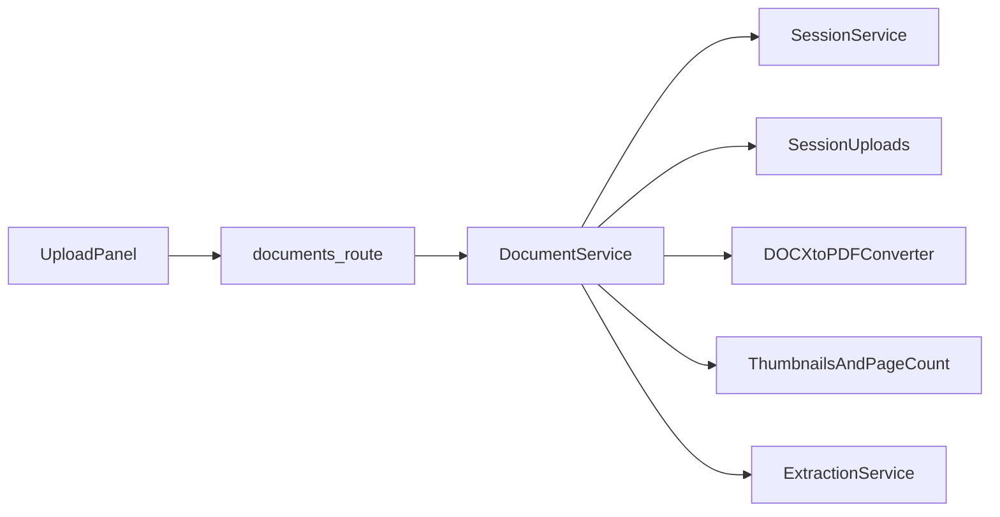
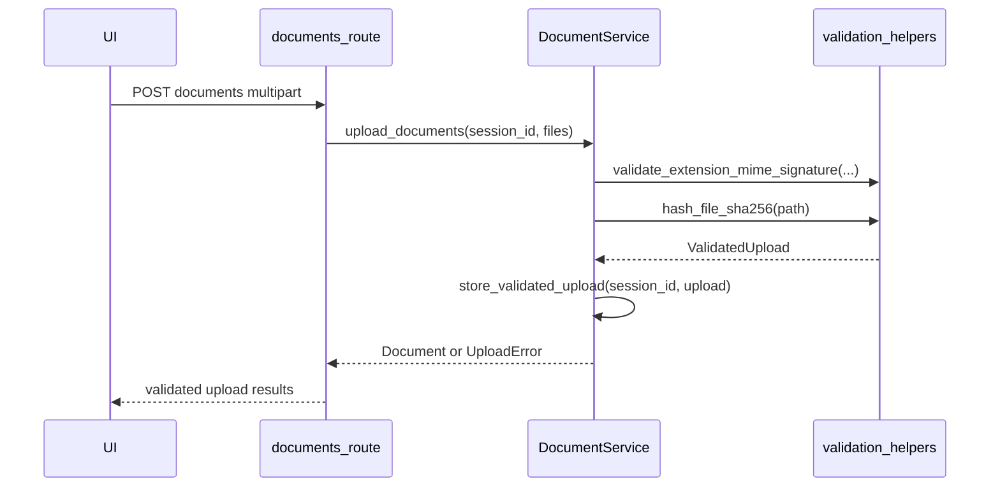
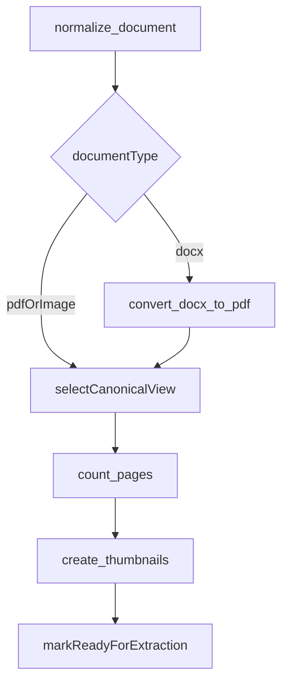
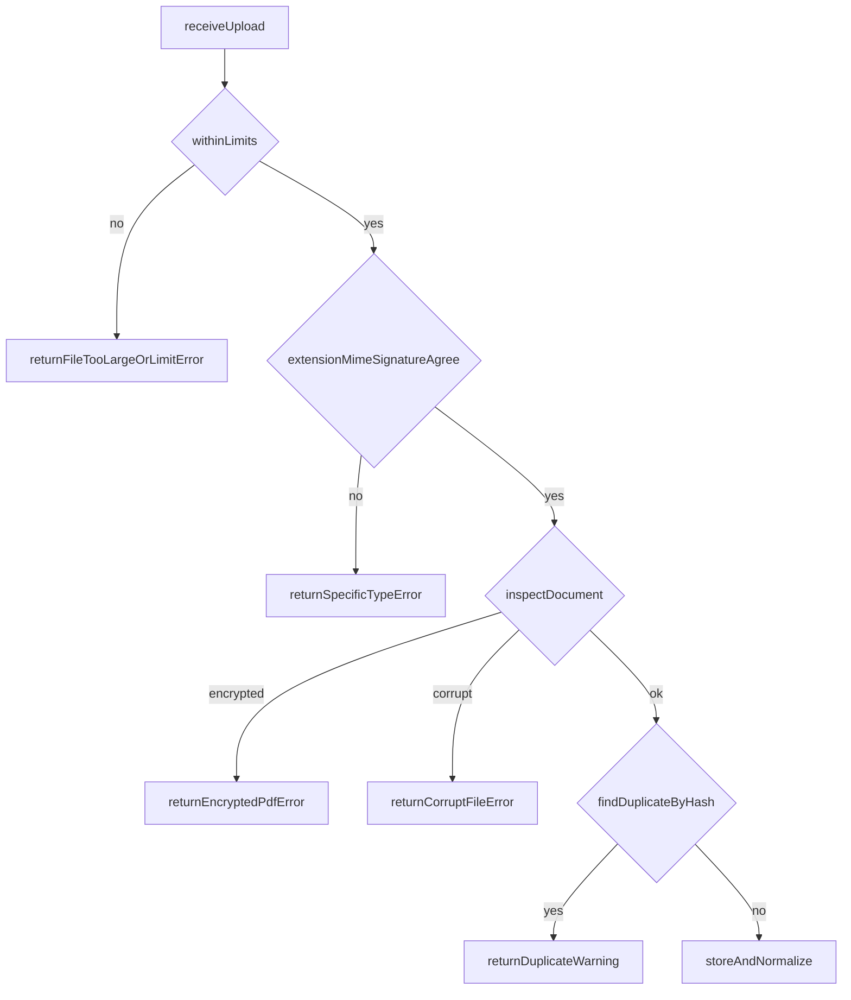

# 02. Upload, Validation, and Normalization

| Field | Value |
|-------|-------|
| Spec | §8.2 / Phase 1 |
| Service(s) | DocumentService |
| Upstream | 00 Repository and Contracts; 01 Session and Workspace |
| Downstream | 03 Page Analysis and Text Extraction; 04 Classification and Sequencing |
| Exit gate | The supplied sample package uploads successfully, duplicates are detected, and malformed files fail safely without stopping the session. |
| Status | design |
| Contracts | [`document.md`](../contracts/entities/document.md); [`DocumentFileType`](../contracts/enums.md) / [`DocumentStatus`](../contracts/enums.md); upload domain in [`error-codes.md`](../contracts/error-codes.md) |

## 1. Purpose
Safely accept supported case documents into an existing temporary session, validate actual content rather than names alone, create canonical working/viewing artifacts, and return `Document` metadata for later extraction without treating any upload as authoritative evidence.

## 2. Responsibilities
- Accept PDF, DOCX, JPG, PNG, and TIFF within file/count/page/total-size limits.
- Validate extension, declared MIME, byte signature, corruption/encryption, and DOCX ZIP structure.
- Save originals with random internal names; retain display name only as metadata.
- Calculate SHA-256 and report exact duplicates without stopping unrelated uploads.
- Generate DOCX canonical PDF viewing copies while preserving the original for structured DOCX extraction; create thumbnails and page counts.
- Do not OCR/extract facts, send files to external scanners/LLMs, use paid DocAI, or persist uploads beyond their session.

## 3. Inputs and outputs
| Inputs | Source | Validation |
|---|---|---|
| multipart files | `POST .../documents` | supported extension/MIME/signature, limits |
| session ID | route | active `CaseSession` |
| AppSettings limits | Phase 0 | Appendix D defaults |

| Outputs | Consumer | Contract |
|---|---|---|
| `Document` records | UI, extraction/classification | metadata, hash, status, page count |
| originals and derived PDFs | session workspace only | random paths never exposed |
| thumbnails | PDF.js/workspace UI | page-indexed derived assets |
| upload errors/warnings | UI | machine code + user message |

| Side effect | Constraint |
|---|---|
| files in `uploads/`, PDFs in `derived/`, thumbnails in `thumbnails/` | deleted at session reset/expiry |

## 4. Functional requirements
| FR | Acceptance note |
|---|---|
| FR-UPL-01 | Accept exactly PDF, DOCX, JPG, PNG, and TIFF, subject to limits. |
| FR-UPL-02 | Extension, MIME, and magic/signature must agree; filename alone never succeeds. |
| FR-UPL-03 | Internal random name is used for every artifact; original display name remains metadata. |
| FR-UPL-04 | SHA-256 identifies exact byte-for-byte duplicates in a session. |
| FR-UPL-05 | Password-protected, corrupt, unsupported, oversized, count/page-limit files return specific safe errors. |
| FR-UPL-06 | DOCX receives canonical PDF view copy while preserving DOCX for `python-docx` structured reading later. |
| FR-UPL-07 | Page count and thumbnails exist for processable canonical views. |

## 5. Proposed design (classes, methods, functions)
All interfaces below are **proposed design** until implemented.

### 5.1 Types / models
- `UploadCandidate`, `ValidatedUpload`, `DocumentArtifact`, `UploadError` — module-local orchestration types (not separate contracts).
- `Document` — [`entities/document.md`](../contracts/entities/document.md).
- `DocumentFileType` — [`enums.md`](../contracts/enums.md) (`pdf`, `docx`, `jpg`, `png`, `tiff`). Do not name this enum `DocumentType` (that name collides with classification).
- `DocumentStatus` — full enum in [`enums.md`](../contracts/enums.md); this module typically sets through `ready_for_extraction`.
- Upload API `error_code` values — [`error-codes.md`](../contracts/error-codes.md) (upload domain). Prefer `upload_*` codes in API responses.

### 5.2 Service API (method list with signatures)
| Proposed method | Called by | Calls | FR mapping | Failure modes |
|---|---|---|---|---|
| `upload_documents(self, session_id: str, files: list[UploadFile]) -> list[Document | UploadError]` | POST route | `validate_upload`, `store_validated_upload` | UPL-01..05 | missing/expired session; per-file rejection |
| `validate_upload(self, upload: UploadFile, limits: UploadLimits) -> ValidatedUpload` | upload orchestration | `detect_signature`, `hash_file_sha256`, `inspect_document` | UPL-01..05 | mismatch, encryption, corruption, limit |
| `store_validated_upload(self, session_id: str, upload: ValidatedUpload) -> Document` | `upload_documents` | `new_internal_filename`, `find_duplicate_by_hash` | UPL-03..04 | disk write failure |
| `normalize_document(self, session_id: str, document_id: str) -> Document` | processing stage | `convert_docx_to_pdf`, `count_pages`, `create_thumbnails` | UPL-06..07 | converter unavailable/corrupt output |
| `list_documents(self, session_id: str) -> list[Document]` | GET route | session lookup | UPL outputs | expired session |

### 5.3 Helpers / pure functions
```python
def hash_file_sha256(path: Path, chunk_size: int = 1_048_576) -> str: ...
def detect_signature(path: Path) -> str | None: ...
def validate_extension_mime_signature(filename: str, mime: str, signature: str | None) -> str: ...
def new_internal_filename(suffix: str) -> str: ...
def inspect_docx_zip(path: Path, max_uncompressed_bytes: int) -> None: ...
def count_pages(canonical_path: Path, file_type: str) -> int: ...
```

### 5.4 API endpoints (if any)
- **Proposed:** `POST /api/v1/sessions/{session_id}/documents` accepts multipart files and returns accepted records plus per-file error objects.
- **Proposed:** `GET /api/v1/sessions/{session_id}/documents` returns metadata/status, never internal paths or raw bytes.

## 6. Detailed flows
### 6.1 Context diagram (Mermaid)


### 6.2 End-to-end sequence (Mermaid sequenceDiagram)


### 6.3 Internal algorithm (Mermaid)


### 6.4 Error / edge-case flow (Mermaid)


## 7. Data contracts

**Contracts SoT:** [`docs/contracts/`](../contracts/README.md). **If this prose conflicts with `docs/contracts/`, contracts win.**

| Contract | Link |
|----------|------|
| Document | [entities/document.md](../contracts/entities/document.md) |
| DocumentFileType / DocumentStatus | [enums.md](../contracts/enums.md) |
| Upload error codes | [error-codes.md](../contracts/error-codes.md) |
| CaseSession (scope) | [entities/case-session.md](../contracts/entities/case-session.md) |

Illustrative JSON (fields from contracts):

```json
{
  "id": "doc_01JQ9N8K",
  "session_id": "ses_01JQ9M7E4H8Q",
  "display_name": "Police Report.pdf",
  "file_type": "pdf",
  "content_sha256": "a1b2c3...f9",
  "page_count": 4,
  "classification": null,
  "status": "ready_for_extraction",
  "exclude_from_drafting": false,
  "treat_as_secondary_evidence": false,
  "page_quality_warning_count": 0
}
```

## 8. UI touchpoints
- Upload drop zone accepts only listed formats and shows each specific rejection message.
- Document list displays original name, page count, duplicate warning, normalization status, and thumbnails.
- DOCX opens through its derived PDF view while its structured DOCX capability remains metadata, not a user-visible local path.

## 9. Testing and exit gate
- Unit: magic/MIME/extension disagreement, SHA-256 determinism, random names, limits, DOCX ZIP decompression bounds.
- Integration: upload all permitted formats; verify originals/derived assets stay below one session root and disappear with the session.
- Fixture tests: `docs/example/` Amini PDFs upload; controlled malformed/encrypted/oversized fixtures produce the exact error code.
- Golden: exact duplicate returns a warning/duplicate result without blocking other sample files; DOCX produces a PDF view copy, page count, thumbnails.
- Exit gate: supplied package succeeds, duplicates are detected, and invalid files fail safely without ending the session.

## 10. Open questions / non-goals
- Non-goal: malware-service upload, archive support, OCR, text extraction, classification, permanent document storage, or external document AI.
- Confirm approved local DOCX-to-PDF converter behavior and bounded timeout for the target Windows environment.
- Page-count handling for multipage TIFF must use the chosen image library without rendering page text.
