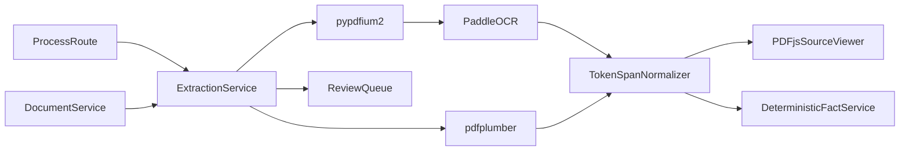
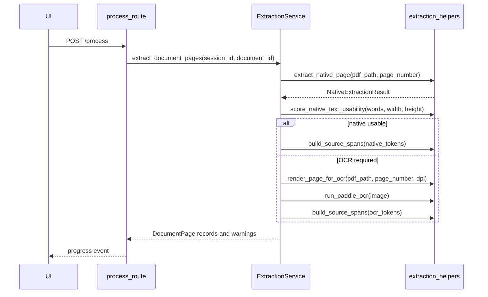
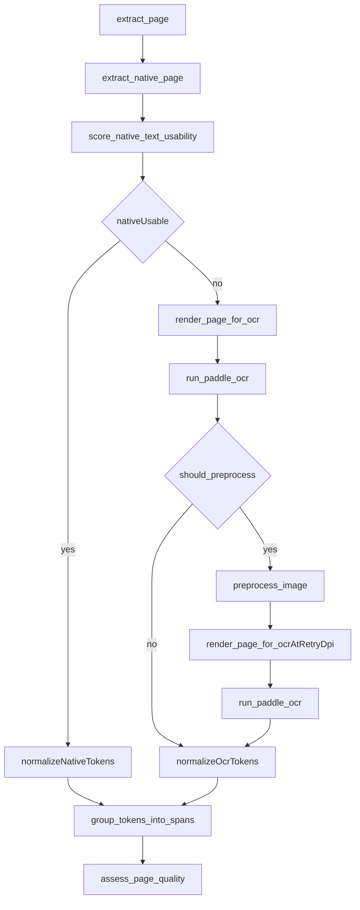
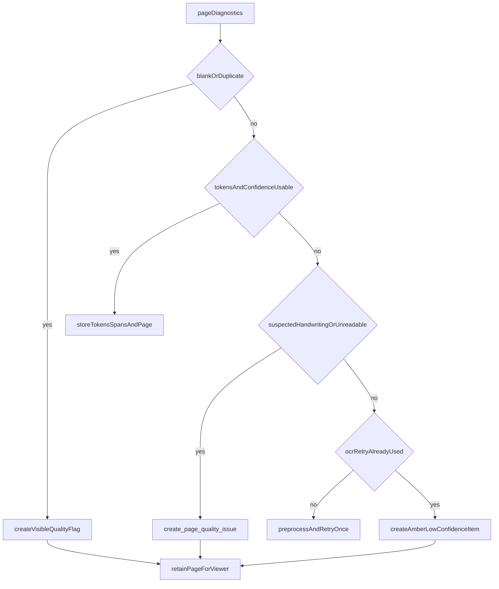

# 03. Page Analysis and Text Extraction

| Field | Value |
|-------|-------|
| Spec | §8.3, §9 / Phases 2–3 |
| Service(s) | ExtractionService, OCR helpers |
| Upstream | 00 Repository and Contracts; 01 Session and Workspace; 02 Upload, Validation, Normalization |
| Downstream | 04 Classification; 05 Deterministic Fact Extraction; 08 Human Review; source viewer |
| Exit gate | Every page in an illustrative sample (or firm eval set) has extractable text or a visible review item, and clicking an extracted span highlights the correct region. |
| Status | design |
| Thresholds | [03-ocr-thresholds.md](./03-ocr-thresholds.md) (`0.1-provisional`) |
| Contracts | [`document-page.md`](../contracts/entities/document-page.md); [`source-token.md`](../contracts/entities/source-token.md); [`source-span.md`](../contracts/entities/source-span.md); [`PageRoute`](../contracts/enums.md) / [`ExtractionMethod`](../contracts/enums.md); [`extraction.*`](../contracts/issue-types.md); [`app-settings.md`](../contracts/entities/app-settings.md) |

## 1. Purpose
Analyze every normalized document page, prefer usable native PDF text, route unusable/scanned pages through free local OCR, and produce one coordinate-normalized token/span evidence format with page-quality warnings. This is the load-bearing OCR → spans → highlights path. Numeric routing and confidence knobs live in [03-ocr-thresholds.md](./03-ocr-thresholds.md). Sample files under `docs/example/` are **illustrative** only—not the sole production document mix.

## 2. Responsibilities
- Extract native words, characters, and coordinates with `pdfplumber`; use `pypdf` only for supporting PDF handling where needed.
- Score native usability using coverage, character count, replacement characters, word geometry, reading order, image coverage, and expected labels.
- Render OCR candidates with `pypdfium2` at configured DPI; apply selective Pillow/OpenCV preprocessing and one retry.
- Run lightweight local PaddleOCR for printed scanned text; retain polygons/confidence.
- Normalize native/OCR output into `SourceToken` and `SourceSpan`, top-left normalized coordinates, and `DocumentPage` quality flags.
- Create Amber/Red/manual-review items for blank, duplicate, truncated, unreadable, handwriting-suspected, or low-confidence pages.
- Do not use an LLM as primary extractor, use paid DocAI, extract final facts, or silently substitute uncertain text.

## 3. Inputs and outputs
| Inputs | Source | Validation |
|---|---|---|
| normalized PDF/image view | `DocumentService` | active session, processable document |
| OCR configuration | Appendix D | default 200 DPI; retry 300 DPI; one worker |
| page metadata/thumbnails | `DocumentService` | page number exists |

| Outputs | Consumer | Contract |
|---|---|---|
| `DocumentPage` | viewer, classification, quality/review | dimensions, coverage, route, flags |
| `SourceToken` | spans and deterministic extraction | text, confidence, polygon, method |
| `SourceSpan` | viewer, facts, manual review | readable excerpt, token IDs, page/polygons/context |
| page-quality warnings/events | UI and issue service | specific issue type and severity |

| Side effect | Constraint |
|---|---|
| renders/preprocessed images under session `derived/work` | temporary only; cleanup through SessionService |
| emits `document.page.processed` progress | no page text in default logs |

## 4. Functional requirements
| FR | Acceptance note |
|---|---|
| FR-EXT-01 | `pdfplumber` native extraction retains words, characters, and original-page geometry. |
| FR-EXT-02 | scorer measures text coverage/count, replacement rate, and reading-order quality before selecting native text. |
| FR-EXT-03 | OCR-routed pages render via `pypdfium2` at configured resolution. |
| FR-EXT-04 | Rotate/light preprocess only when diagnostics warrant it; retry once, not indefinitely. |
| FR-EXT-05 | PaddleOCR handles scanned typed pages and returns polygons/confidence. |
| FR-EXT-06 | Both paths create the same normalized token/span contracts. |
| FR-EXT-07 | Page warnings explicitly cover unreadable, blank, duplicate, truncated, and low-confidence content. |
| §9.1 routing | Native first; OCR is expected for police/insurer/long clinical scans; uncertain/handwritten pages become review items. |
| §9.3 policy | Confidence combines recognition, source, agreement, criticality, and validation—not one global threshold. |

## 5. Proposed design (classes, methods, functions)
All interfaces below are **proposed design** until implemented.

### 5.1 Types / models
- Orchestration: `NativeExtractionResult`, `OcrResult`, `PageDiagnostics`, `PageQualityFlag` (module-local).
- `DocumentPage` — [`entities/document-page.md`](../contracts/entities/document-page.md).
- `SourceToken` — [`entities/source-token.md`](../contracts/entities/source-token.md).
- `SourceSpan` — [`entities/source-span.md`](../contracts/entities/source-span.md).
- `ExtractionMethod`, `PageRoute` — [`enums.md`](../contracts/enums.md). Coordinates follow prototype §7.3 / contracts global rules.
- Page-quality issues use dotted `extraction.*` codes in [`issue-types.md`](../contracts/issue-types.md). Threshold knobs: [03-ocr-thresholds.md](./03-ocr-thresholds.md).

### 5.2 Service API (method list with signatures)
| Proposed method | Called by | Calls | FR mapping | Failure modes |
|---|---|---|---|---|
| `extract_document_pages(self, session_id: str, document_id: str) -> list[DocumentPage]` | process stage | `extract_page`, progress emitter | EXT-01..07 | invalid document/page rendering failure |
| `extract_page(self, document: Document, page_number: int) -> DocumentPage` | document loop | native/OCR route helpers | EXT-01..07, §9.1 | per-page failure creates quality item |
| `extract_native_page(self, canonical_pdf: Path, page_number: int) -> NativeExtractionResult` | `extract_page` | `pdfplumber_extract_words` | EXT-01 | malformed text layer |
| `select_page_route(self, diagnostics: PageDiagnostics) -> PageRoute` | `extract_page` | `score_native_text_usability` | EXT-02, §9.1 | ambiguous score → OCR/manual |
| `extract_ocr_page(self, canonical_pdf: Path, page_number: int) -> OcrResult` | OCR route | render/preprocess/Paddle helpers | EXT-03..05 | OCR engine/render failure |
| `build_source_spans(self, tokens: list[SourceToken]) -> list[SourceSpan]` | either route | `group_tokens_into_spans` | EXT-06 | geometry/order warning |
| `assess_page_quality(self, page: DocumentPage) -> list[PageQualityFlag]` | page completion | `detect_blank_or_duplicate_page` | EXT-07, §9.3 | quality flags never discard evidence |

### 5.3 Helpers / pure functions
```python
def score_native_text_usability(
    words: list[NativeWord], page_width: float, page_height: float
) -> PageDiagnostics: ...

def render_page_for_ocr(pdf_path: Path, page_number: int, dpi: int) -> Image.Image: ...

def should_preprocess(diagnostics: PageDiagnostics, ocr_result: OcrResult | None = None) -> bool: ...

def preprocess_image(image: Image.Image, *, rotation_degrees: int | None) -> Image.Image: ...

def run_paddle_ocr(image: Image.Image) -> OcrResult: ...

def normalize_polygon(points: list[tuple[float, float]], width: float, height: float) -> list[tuple[float, float]]: ...

def group_tokens_into_spans(tokens: list[SourceToken]) -> list[SourceSpan]: ...
```

### 5.4 API endpoints (if any)
No dedicated extraction endpoint is required in this phase. **Proposed:** `POST /api/v1/sessions/{session_id}/process` invokes the session-scoped pipeline; `GET /api/v1/sessions/{session_id}/events` reports `document.page.processed`. Later viewer/fact routes consume persisted-in-memory page/token/span contracts.

## 6. Detailed flows
### 6.1 Context diagram (Mermaid)


### 6.2 End-to-end sequence (Mermaid sequenceDiagram)


### 6.3 Internal algorithm (Mermaid)


### 6.4 Error / edge-case flow (Mermaid)


## 7. Data contracts

**Contracts SoT:** [`docs/contracts/`](../contracts/README.md). **If this prose conflicts with `docs/contracts/`, contracts win.**

| Contract | Link |
|----------|------|
| DocumentPage | [entities/document-page.md](../contracts/entities/document-page.md) |
| SourceToken | [entities/source-token.md](../contracts/entities/source-token.md) |
| SourceSpan | [entities/source-span.md](../contracts/entities/source-span.md) |
| PageRoute / ExtractionMethod | [enums.md](../contracts/enums.md) |
| Extraction issue types | [issue-types.md](../contracts/issue-types.md) (`extraction.*`) |
| Thresholds / AppSettings knobs | [03-ocr-thresholds.md](./03-ocr-thresholds.md), [app-settings.md](../contracts/entities/app-settings.md) |

Illustrative JSON (fields from contracts):

```json
{
  "document_page": {
    "document_id": "doc_01JQ9N8K",
    "page_number": 1,
    "width": 612.0,
    "height": 792.0,
    "text_coverage": 0.14,
    "extraction_method": "ocr",
    "ocr_status": "completed",
    "quality_flags": [{"type": "low_ocr_confidence", "severity": "amber"}]
  },
  "source_token": {
    "id": "tok_doc_01_p1_001",
    "text": "Date",
    "confidence": 0.97,
    "polygon": [[0.12, 0.22], [0.17, 0.22], [0.17, 0.24], [0.12, 0.24]],
    "method": "ocr"
  },
  "source_span": {
    "id": "span_doc_01_p1_01",
    "text": "Date of Loss: 03/28/2026",
    "token_ids": ["tok_doc_01_p1_001", "tok_doc_01_p1_002"],
    "page_number": 1,
    "polygons": [[[0.12, 0.22], [0.44, 0.22], [0.44, 0.25], [0.12, 0.25]]],
    "context": "collision report header"
  }
}
```

## 8. UI touchpoints
- Processing progress shows document/page/stage via `document.page.processed`.
- Source viewer renders canonical PDF pages, thumbnails, normalized highlight polygons, text, method, and confidence.
- Page warnings open visible Amber/Red review items; manual source selection belongs to Module 08.

## 9. Testing and exit gate
- Unit: native usability scoring, polygon normalization, span grouping, preprocessing decision, retry-once behavior, quality flag rules — against knobs in [03-ocr-thresholds.md](./03-ocr-thresholds.md).
- Integration: `pdfplumber` native digital page and `pypdfium2`/PaddleOCR scanned page produce the same token/span shape.
- Illustrative sample (optional): `docs/example/` may be used to exercise OCR-first vs native routes; results are **not** product SLAs. Fill the Measured baselines table in the thresholds addendum when ready.
- Viewer: clicking a span highlights its intended page region at multiple zoom levels.
- Failure: unreadable, blank, duplicate, truncated, low-confidence, and handwriting-suspected fixtures create visible review items—not invented text.
- Exit gate: every processed page has extractable text or an explicit review item with correct highlightable provenance.

## 10. Open questions / non-goals
- Non-goal: paid DocAI, LLM-first extraction, full-document LLM prompts, semantic fact extraction, table model training, or final fact decisions.
- Rare vision crop fallback remains assistive only under its configuration flag and may not create verified evidence.
- Calibrate native/OCR thresholds using [03-ocr-thresholds.md](./03-ocr-thresholds.md); treat any `docs/example/` timings as illustrative only.
