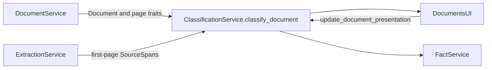
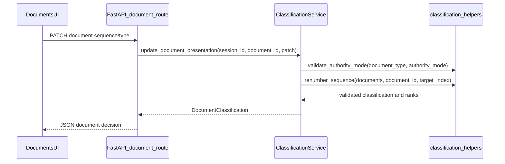
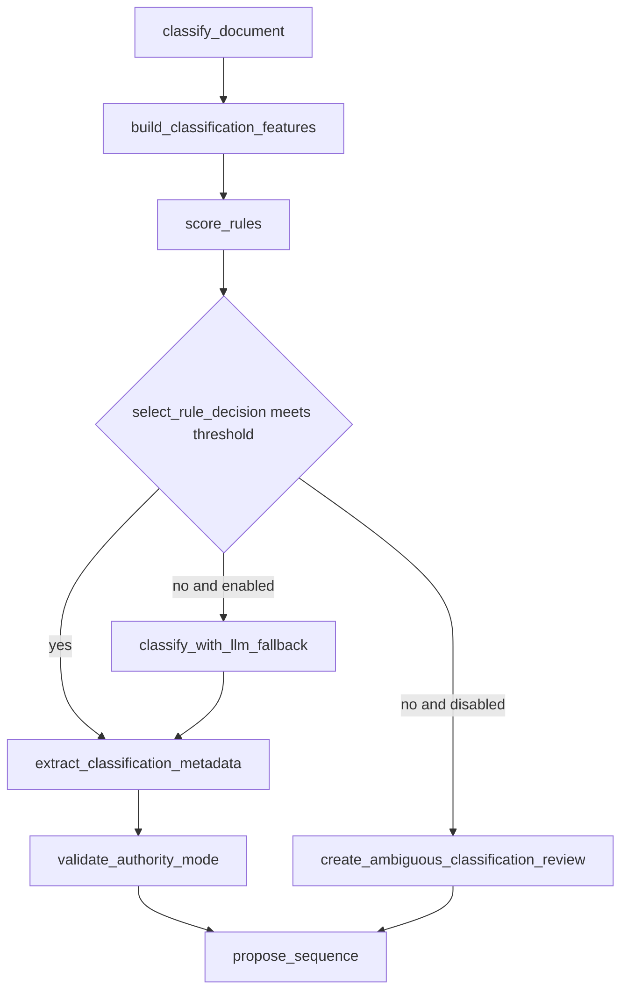
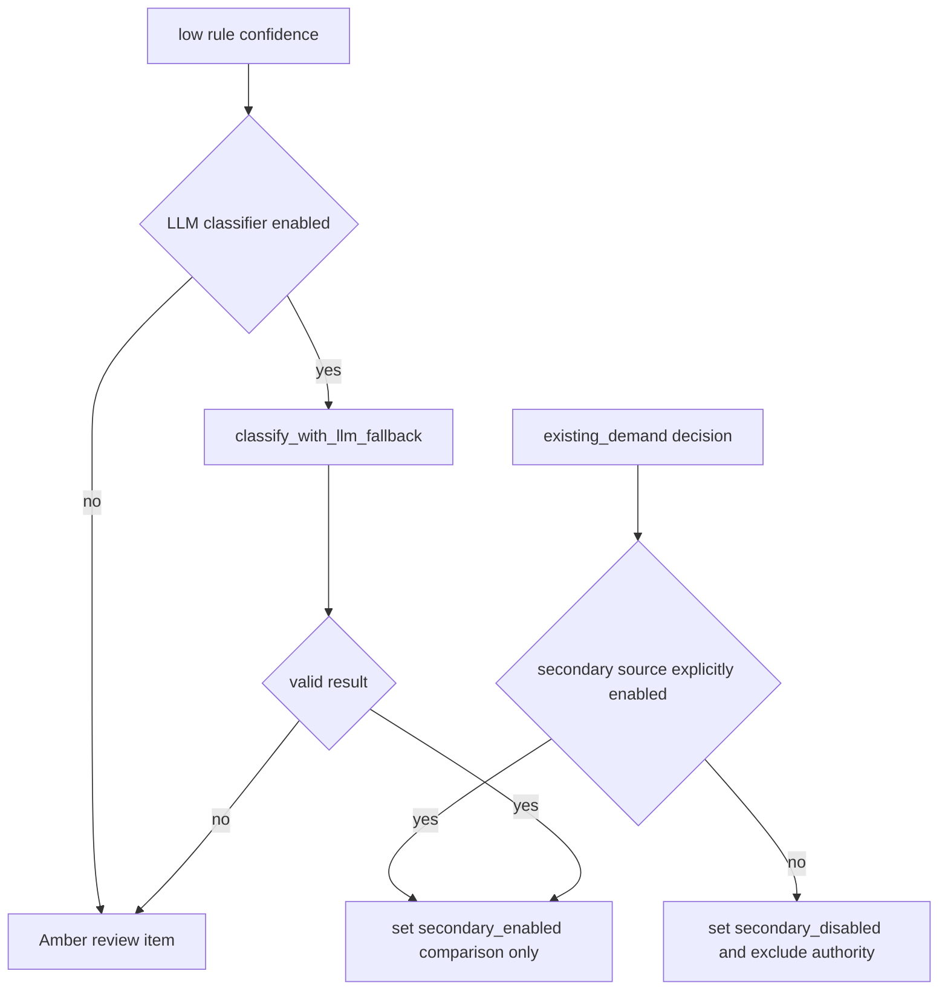

# 04. Document Classification and Sequencing

| Field | Value |
|-------|-------|
| Spec | §8.4 / Phase 4 |
| Service(s) | ClassificationService |
| Upstream | [02 Upload, Validation, Normalization](./02-upload-validation-normalization.md); [03 Page Analysis and Text Extraction](./03-page-analysis-and-text-extraction.md) |
| Downstream | [05 Deterministic Fact Extraction](./05-deterministic-fact-extraction.md); [06 Chronology and Billing](./06-chronology-and-billing.md); [07 Issue Engine](./07-issue-and-contradiction-engine.md) |
| Exit gate | All sample files are correctly classified or surfaced for quick correction, and users can reorder without reprocessing. |
| Status | design |
| Contracts | [`document.md`](../contracts/entities/document.md); [`DocumentClassification`](../contracts/enums.md); metadata facts via [`fact.md`](../contracts/entities/fact.md) |

## 1. Purpose
Classify each extracted document with deterministic evidence, capture limited metadata, and propose a review order. Rules are authoritative for the normal path; a low-cost LLM can only break low-confidence classification ties and never promotes an existing demand to evidence authority.

## 2. Responsibilities
- Own document-type scoring, classification rationale, metadata candidates, and mutable sequence positions.
- Support the §8.4 taxonomy: police report, insurer correspondence, medical record, imaging report, bill/ledger, lien, wage loss, photographs, existing demand, template, and other.
- Preserve user classification/order corrections without rerunning OCR or extraction.
- Treat an existing demand as excluded from authoritative evidence unless the user expressly enables it as a secondary source.
- Does not extract case facts, send full files to an LLM, persist data beyond the session, or decide legal relevance.

## 3. Inputs and outputs
| Input | Source | Use |
|---|---|---|
| `Document`, filename, MIME and page traits | DocumentService | Rule features |
| First-page `SourceSpan`/tokens | ExtractionService | Heading and phrase features |
| Session configuration and user correction | API/UI | LLM permission, sequence override |

| Output | Consumer | Contents |
|---|---|---|
| `DocumentClassification` | Documents UI, FactService | type, confidence, reasons, metadata |
| `SequenceProposal` | Documents UI, downstream stages | rank and user override |
| `Issue` | Issue/review queue | ambiguous or prohibited authority state |

| Side effect | Detail |
|---|---|
| Session-state mutation | Updates classification, metadata, sequence, and authority flag only; no new permanent storage or files. |
| Event | `document.classified` after each successful decision. |

## 4. Functional requirements
| FR | Acceptance note |
|---|---|
| FR-CLS-01 | `score_rules()` uses filename, first-page headings/key phrases, and page characteristics and records matched evidence. |
| FR-CLS-02 | `classify_with_llm_fallback()` runs only if rules score below `rule_confidence_threshold` and LLM classification is enabled. |
| FR-CLS-03 | `DocumentClassification` enum supports the complete §8.4 taxonomy; imaging can remain a section of a medical bundle. |
| FR-CLS-04 | Provider, insurer, claimant, and date-range candidates retain source spans and confidence where applicable. |
| FR-CLS-05 | `propose_sequence()` creates a logical order; `update_document_presentation()` accepts a drag-and-drop order without processing. |
| FR-CLS-06 | Existing demand defaults to `authority_mode="secondary_disabled"`; only explicit user enablement permits secondary comparison use. |

## 5. Proposed design (classes, methods, functions)
All names in this section are **proposed design** until implemented.

### 5.1 Types / models
- `DocumentClassification` (enum) — values in [`enums.md`](../contracts/enums.md) (`police_report`, `insurer_correspondence`, …). Do not invent a parallel `DocumentType` enum for classification.
- Classification **result** fields live on [`Document`](../contracts/entities/document.md) (`classification`, `classification_confidence`, `classification_reason`, `sequence_index`, `treat_as_secondary_evidence`, …).
- Metadata fields (provider/insurer/claimant/date range) are [`Fact`](../contracts/entities/fact.md) instances with appropriate `FactStatus` (typically `suggested` until review), not a separate type.
- Module-local: `ClassificationFeatures`, `RuleScore`, `ClassificationDecision`, `SequenceProposal`, `DocumentPresentationPatch`, `AuthorityMode` (`authoritative` \| `secondary_disabled` \| `secondary_enabled`).

### 5.2 Service API (method list with signatures)
| Proposed method | Called by | Calls | FR | Failure modes |
|---|---|---|---|---|
| `classify_document(session_id: str, document_id: str) -> DocumentClassification` | processing stage | `build_features`, `score_rules`, optional fallback, `propose_sequence` | 01–04, 06 | Missing text yields low confidence/review; no silent type guess |
| `classify_session(session_id: str) -> list[DocumentClassification]` | `POST .../process` | `classify_document`, `propose_sequence` | 01–05 | Per-document failure is surfaced and other files continue |
| `update_document_presentation(session_id: str, document_id: str, patch: DocumentPresentationPatch) -> DocumentClassification` | PATCH document route | `validate_authority_mode`, `renumber_sequence` | 05–06 | Invalid rank/type or unauthorized authority request returns validation error |
| `classify_with_llm_fallback(features: ClassificationFeatures) -> ClassificationDecision | None` | `classify_document` | `build_classifier_prompt` | 02 | Disabled/provider/schema failure returns `None` and creates review item |

### 5.3 Helpers / pure functions
- `build_classification_features(document, first_page_spans) -> ClassificationFeatures`
- `score_rules(features) -> list[RuleScore]`
- `select_rule_decision(scores, threshold) -> ClassificationDecision | None`
- `extract_classification_metadata(features) -> MetadataCandidates`
- `propose_sequence(classifications) -> list[SequenceProposal]`
- `validate_authority_mode(classification, requested_mode) -> AuthorityMode`
- `renumber_sequence(documents, moved_document_id, target_index) -> list[SequenceProposal]`

### 5.4 API endpoints (if any)
- `PATCH /api/v1/sessions/{session_id}/documents/{document_id}` corrects classification, display label, sequence, exclusion, or FR-CLS-06 authority setting.
- `GET /api/v1/sessions/{session_id}/documents` returns decisions and ordering. Classification is normally invoked by `POST /api/v1/sessions/{session_id}/process`.

## 6. Detailed flows
### 6.1 Context diagram (Mermaid)


### 6.2 End-to-end sequence (Mermaid sequenceDiagram)


### 6.3 Internal algorithm (Mermaid flowchart) down to method calls


### 6.4 Error / edge-case flow (Mermaid)


## 7. Data contracts

**Contracts SoT:** [`docs/contracts/`](../contracts/README.md). **If this prose conflicts with `docs/contracts/`, contracts win.**

| Contract | Link |
|----------|------|
| Document (classification fields) | [entities/document.md](../contracts/entities/document.md) |
| DocumentClassification enum | [enums.md](../contracts/enums.md) |
| Fact (metadata candidates) | [entities/fact.md](../contracts/entities/fact.md) |

Illustrative classification decision payload (maps onto Document + optional Fact refs):

```json
{
  "document_id": "doc_01",
  "classification": "medical_record",
  "classification_confidence": 0.93,
  "classification_reason": "heading: PATIENT INFORMATION; filename: clinic_records.pdf",
  "sequence_index": 4,
  "treat_as_secondary_evidence": false,
  "metadata_fact_ids": ["fact_01JEXAMPLE0000000000000C9"]
}
```

## 8. UI touchpoints
The Documents screen shows type, confidence/reason, page traits, warning count, and proposed order. It supports type correction, display-name edit, drag-and-drop sequence, exclusion, and the explicit secondary-source toggle for an existing demand. Ambiguous rows direct the user to an Amber review state.

## 9. Testing and exit gate
- Unit: taxonomy validation, rule weights, threshold boundaries, sequencing, and FR-CLS-06 authority transitions.
- Integration: process the Amini evidence PDFs; change order/type and assert no OCR/extraction job reruns.
- Golden: expected type and metadata for `docs/example/`; the Amini demand remains non-authoritative unless the FR-CLS-06 test enables it.
- Exit: every sample document is classified or quickly correctable, and reordering is instant and preserved in session state.

## 10. Open questions / non-goals
- Thresholds and rule dictionaries require corpus measurement; they are not asserted by this design.
- LLM fallback uses only compact classification features, never complete documents, and is optional.
- This module does not infer facts, extract semantic medical findings, or determine evidentiary/legal authority beyond the FR-CLS-06 guard.
