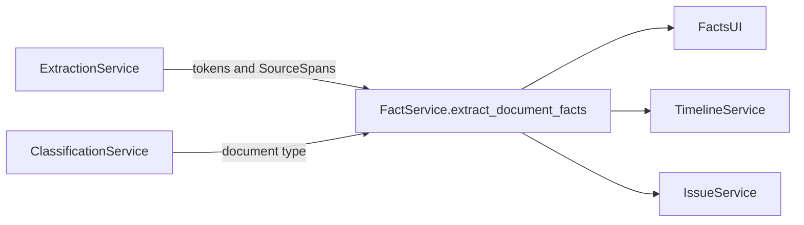
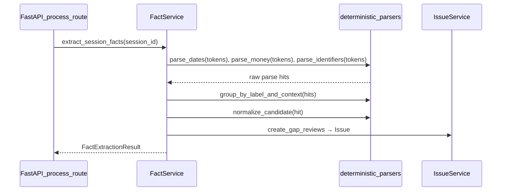
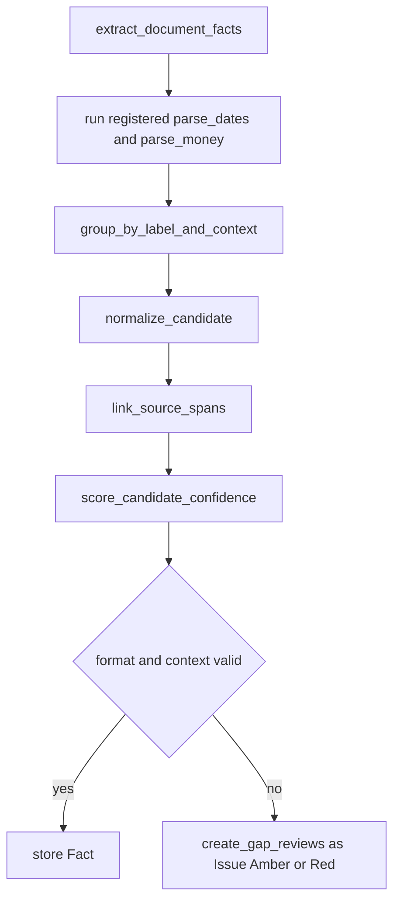
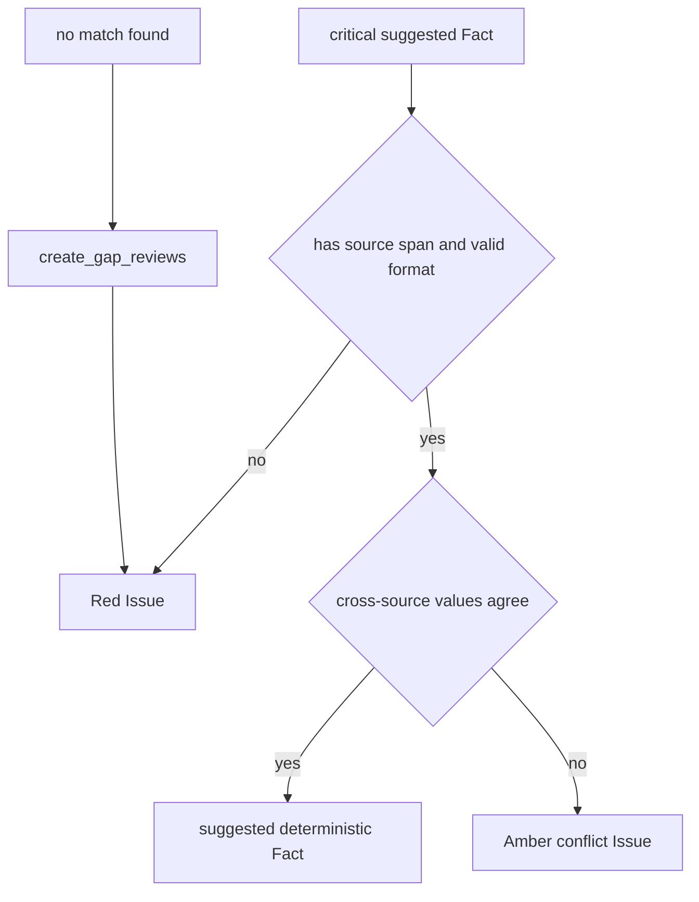

# 05. Deterministic Fact Extraction

| Field | Value |
|-------|-------|
| Spec | §8.5 / Phase 5 (extraction MVP) |
| Service(s) | FactService |
| Upstream | [03 Page Analysis and Text Extraction](./03-page-analysis-and-text-extraction.md); [04 Document Classification](./04-document-classification-and-sequencing.md) |
| Downstream | [06 Chronology and Billing](./06-chronology-and-billing.md); [07 Issue Engine](./07-issue-and-contradiction-engine.md); human review and drafting |
| Exit gate | Known identity, claim, date, and amount fields are source-linked with no invented values; critical gaps are in review. |
| Status | design |
| Parser catalog | [05-fact-parser-catalog.md](./05-fact-parser-catalog.md) (`0.1-provisional`) |
| Contracts | [`fact.md`](../contracts/entities/fact.md); [`issue.md`](../contracts/entities/issue.md); [`fact-types.md`](../contracts/fact-types.md); [`FactStatus`](../contracts/enums.md); gold [`docs/example/gold/`](../example/gold/README.md) |

## 1. Purpose
Build the complete extraction MVP from normalized tokens and spans using deterministic parsers, context grouping, normalization, source links, confidence, and review `Issue`s. Parser label cues and patterns live in [05-fact-parser-catalog.md](./05-fact-parser-catalog.md). This module does not call an LLM: `ENABLE_LLM_SEMANTIC_EXTRACTION=false` is the default and LLM output is never the primary extractor.

## 2. Responsibilities
- Extract exact values: dates/times/DOB, phones, email, claim/policy/report/citation IDs, providers, currency, CPT, and ICD-10.
- Preserve raw evidence while producing normalized values, confidence, and source-span references.
- Group matches by labels and page-local context; calculate ranges, counts, and totals in code.
- Emit Amber/Red `Issue`s (via ephemeral `FactReview` helpers) for uncertain, invalid, or cross-source-conflicting critical fields.
- Does not invent, fill missing facts, resolve legal/medical ambiguity, use paid DocAI, or send PDFs/page dumps to an LLM.

## 3. Inputs and outputs
| Input | Source | Use |
|---|---|---|
| `SourceToken` and `SourceSpan` | ExtractionService | Evidence and coordinate links |
| Classification and metadata | ClassificationService | Parser routing/context |
| Session fact edits/locks | review UI | Preserve approved decisions |

| Output | Consumer | Contents |
|---|---|---|
| `Fact` | Facts UI, Timeline/Billing | raw/normalized value, type, confidence, sources; status often `suggested` pre-review |
| `FactGroup` (ephemeral) | IssueService | grouped/duplicate/conflict helpers — not a contracted entity |
| `Issue` | review queue | Amber/Red gap, format, or cross-check failure (created from `FactReview` helpers) |

| Side effect | Detail |
|---|---|
| Session-state mutation | Suggested facts and `Issue`s only; no permanent DB or temporary-file creation. |
| Event | `fact.extracted` and `fact.review_required` / `issue.detected`. |

## 4. Functional requirements
| FR | Acceptance note |
|---|---|
| FR-DET-01 | Deterministic parser registry covers every named exact-value type. |
| FR-DET-02 | `normalize_candidate()` retains raw text and stores typed normalized value. |
| FR-DET-03 | `group_by_label_and_context()` requires nearby labels/context rather than accepting regex alone. |
| FR-DET-04 | Every accepted fact has `source_span_ids` and calculated confidence. |
| FR-DET-05 | `calculate_service_ranges`, `count_visits`, and `sum_money` run in code. |
| FR-DET-06 | Critical uncertainty, malformed format, or disagreement becomes Amber/Red `Issue`; no default value is fabricated. |

## 5. Proposed design (classes, methods, functions)
All names in this section are **proposed design** until implemented.

### 5.1 Types / models
- `Fact` — [`entities/fact.md`](../contracts/entities/fact.md). Use `Fact` + `FactStatus` (do not introduce a separate `FactCandidate` type).
- `fact_type` values — [`fact-types.md`](../contracts/fact-types.md) (dotted, e.g. `claim.number`).
- `FactStatus` — [`enums.md`](../contracts/enums.md) (`suggested`, `verified`, `edited`, `conflicting`, `needs_review`, `rejected`, `locked`).
- Module-local ephemeral: `FactReview` (maps to `Issue` creation), `FactGroup` (feeds IssueService), `FactPatch`, `FactExtractionResult`. See [Derived / ephemeral types](../contracts/README.md).
- Parser registry rows — [05-fact-parser-catalog.md](./05-fact-parser-catalog.md).

### 5.2 Service API (method list with signatures)
| Proposed method | Called by | Calls | FR | Failure modes |
|---|---|---|---|---|
| `extract_document_facts(session_id: str, document_id: str) -> list[Fact]` | processing stage | parser registry, grouping, normalization, validation | 01–04, 06 | Missing/poor text produces `Issue`s, not guesses |
| `extract_session_facts(session_id: str) -> FactExtractionResult` | `POST .../process` | `extract_document_facts`, calculations, cross-checks | 01–06 | Isolated document failure is retained as visible warning |
| `reconcile_facts(session_id: str) -> list[Issue]` | Facts UI/IssueService | `detect_exact_conflicts`, `create_gap_reviews` | 03, 06 | Conflicts remain unresolved until user action; ephemeral `FactReview` becomes `Issue` |
| `apply_fact_review(session_id: str, fact_id: str, patch: FactPatch) -> Fact` | PATCH fact route | `validate_user_value` | 02, 04, 06 | Invalid user edit keeps prior fact and returns validation error |

### 5.3 Helpers / pure functions
- `parse_dates`, `parse_times`, `parse_identifiers`, `parse_money`, `parse_cpt_codes`, `parse_icd10_codes`, `parse_provider_names`
- `normalize_date`, `normalize_identifier`, `normalize_currency`, `normalize_name`, `normalize_code`
- `group_by_label_and_context`, `score_candidate_confidence`, `link_source_spans`
- `calculate_service_ranges`, `count_visits`, `sum_money`, `create_gap_reviews`

### 5.4 API endpoints (if any)
- `GET /api/v1/sessions/{session_id}/facts` returns grouped suggested facts, status, confidence, and source links.
- `PATCH /api/v1/sessions/{session_id}/facts/{fact_id}` verifies, edits, locks, or rejects a fact.
- `POST /api/v1/sessions/{session_id}/source-spans/manual` creates a user-selected source region for manual completion.

## 6. Detailed flows
### 6.1 Context diagram (Mermaid)


### 6.2 End-to-end sequence (Mermaid sequenceDiagram)


### 6.3 Internal algorithm (Mermaid flowchart) down to method calls


### 6.4 Error / edge-case flow (Mermaid)


## 7. Data contracts

**Contracts SoT:** [`docs/contracts/`](../contracts/README.md). **If this prose conflicts with `docs/contracts/`, contracts win.**

| Contract | Link |
|----------|------|
| Fact | [entities/fact.md](../contracts/entities/fact.md) |
| Issue (queue SoT) | [entities/issue.md](../contracts/entities/issue.md) |
| fact_type catalog | [fact-types.md](../contracts/fact-types.md) |
| FactStatus | [enums.md](../contracts/enums.md) |
| SourceSpan | [entities/source-span.md](../contracts/entities/source-span.md) |
| Parser catalog | [05-fact-parser-catalog.md](./05-fact-parser-catalog.md) |
| Illustrative gold | [docs/example/gold/](../example/gold/README.md) |

Illustrative JSON (fields from contracts):

```json
{
  "id": "fact_01JEXAMPLE0000000000000C1",
  "session_id": "ses_01JEXAMPLE000000000000000",
  "fact_type": "claim.number",
  "raw_value": "CLM- 00123",
  "normalized_value": "CLM-00123",
  "confidence": 0.98,
  "status": "suggested",
  "source_span_ids": ["span_01JEXAMPLE0000000000000B1"],
  "extraction_methods": ["regex", "context_parser"],
  "label_context": "Claim Number",
  "provenance": "deterministic"
}
```

## 8. UI touchpoints
The Facts panel groups suggested facts by category and displays raw/normalized values, confidence, source count, conflicts, and provenance. Selecting a fact opens its exact spans in the source viewer. Amber/Red `Issue`s lead to review/edit/lock actions; manual source spans support a user-provided value without representing it as extracted.

## 9. Testing and exit gate
- Unit: every parser/normalizer, label-window rules, source linking, `Decimal` money summation, service-range and visit-count calculations — aligned to [05-fact-parser-catalog.md](./05-fact-parser-catalog.md).
- Integration: tokens from native/OCR pages reach grouped, source-linked facts; disabled LLM configuration causes no extraction call.
- Golden (illustrative): use [`docs/example/gold/amini-illustrative.md`](../example/gold/amini-illustrative.md) as the **example** acceptance shape for must-find / must-queue / must-not-invent. `docs/example/` is sample material only — copy [`GOLD_CASE_TEMPLATE.md`](../example/gold/GOLD_CASE_TEMPLATE.md) for firm-approved eval cases. Phase 10 runner: [module 12](./12-evaluation-demonstration.md).
- Exit: the extraction MVP meets §17.0 correctness: correct normalized value plus correct span, or an explicit review state. Silent inventing is zero.

## 10. Open questions / non-goals
- Grow label synonyms via the [parser catalog](./05-fact-parser-catalog.md) when eval misses appear; do not hardcode a single sample package.
- Semantic symptoms, narrative diagnoses, causation, and consolidation are deferred (catalog §5 / optional Module 11) and remain off by default.
- This module does not decide which conflicting fact is true, perform OCR, or draft a demand.
