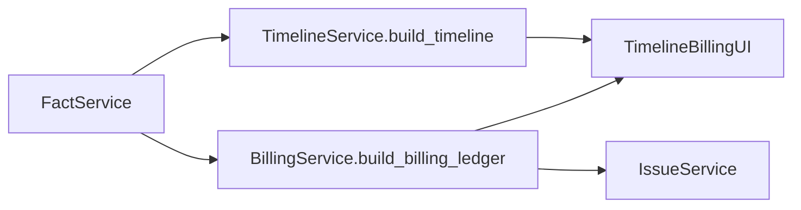
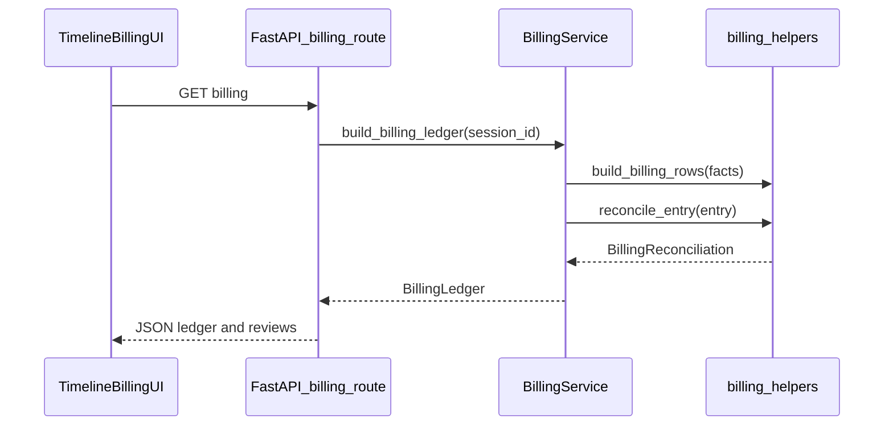
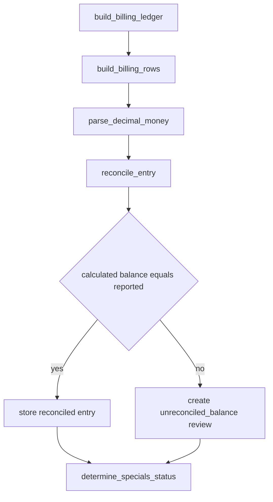
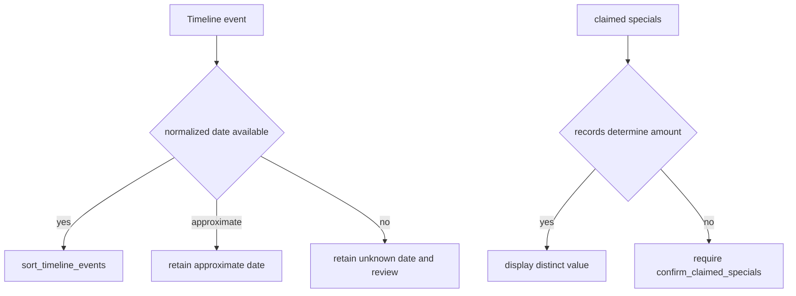

# 06. Chronology and Billing

| Field | Value |
|-------|-------|
| Spec | §8.7 / Phase 6 |
| Service(s) | TimelineService, BillingService |
| Upstream | [05 Deterministic Fact Extraction](./05-deterministic-fact-extraction.md); [04 Document Classification](./04-document-classification-and-sequencing.md) |
| Downstream | [07 Issue Engine](./07-issue-and-contradiction-engine.md); demand generation; review UI |
| Exit gate | Evidence-matching chronology/provider totals, with every charge/payment/balance ambiguity visible. |
| Status | design |
| Contracts | [`timeline-event.md`](../contracts/entities/timeline-event.md); [`billing-entry.md`](../contracts/entities/billing-entry.md); [`fact.md`](../contracts/entities/fact.md); [`billing.*`](../contracts/issue-types.md) |

## 1. Purpose
Convert deterministic, source-linked facts into reproducible chronology events, provider treatment summaries, billing rows, and reconciliation results. Money in API JSON is decimal **strings** (compute with `Decimal` in code); ambiguity about legally claimed specials is shown to the user for confirmation rather than inferred.

## 2. Responsibilities
- Create collision, treatment, imaging, correspondence, billing, discharge, and settlement events.
- Sort normalized dates while preserving unknown and approximate dates.
- Build provider-specific treatment ranges and visit counts.
- Extract/classify charges, payments, adjustments, balances, totals, liens, and specials; reconcile arithmetic in code.
- Require user confirmation where the legally claimed amount cannot be determined.
- Does not use an LLM as a prerequisite, round money through floats, or choose an unsupported claimed amount.

## 3. Inputs and outputs
| Input | Source | Use |
|---|---|---|
| `Fact` and source spans | FactService | dates, provider, money, labels |
| Document classifications | ClassificationService | billing/correspondence context |
| User claimed-amount confirmation | Timeline & Billing UI | attorney/user decision |

| Output | Consumer | Contents |
|---|---|---|
| `TimelineEvent`, `ProviderTreatmentSummary` | Timeline UI, drafting | date precision and linked evidence |
| `BillingEntry`, `BillingReconciliation` | Billing UI, IssueService | Decimal components and discrepancy |
| `Issue` | review queue | unknown date, unreconciled totals, undetermined specials |

| Side effect | Detail |
|---|---|
| Session-state mutation | Timeline, billing ledger, reconciliation, and explicit confirmation history; no permanent storage. |
| Event | `timeline.built`, `billing.reconciled`, `billing.specials_confirmed`. |

## 4. Functional requirements
| FR | Acceptance note |
|---|---|
| FR-CHR-01 | `build_timeline()` emits all seven §8.7 event categories where source facts support them. |
| FR-CHR-02 | `sort_timeline_events()` orders known normalized dates and retains approximate/unknown values visibly. |
| FR-CHR-03 | `summarize_provider_treatment()` derives range and visit count from dated evidence. |
| FR-BIL-01 | `build_billing_rows()` recognizes charge/payment/adjustment/balance/total lines. |
| FR-BIL-02 | `reconcile_entry()` compares `charge - payment - adjustment` with reported balance using `Decimal`. |
| FR-BIL-03 | Ledger keeps charged, paid, outstanding, lien, and claimed-specials values distinct. |
| FR-BIL-04 | `confirm_claimed_specials()` is required when records do not establish the legally claimed amount. |

## 5. Proposed design (classes, methods, functions)
All names in this section are **proposed design** until implemented.

### 5.1 Types / models
- `TimelineEvent` — [`entities/timeline-event.md`](../contracts/entities/timeline-event.md); `TimelineEventType` in [`enums.md`](../contracts/enums.md).
- `BillingEntry` — [`entities/billing-entry.md`](../contracts/entities/billing-entry.md) (money fields as decimal strings in JSON).
- Module-local: `ProviderTreatmentSummary`, `BillingLedger`, `BillingReconciliation`, `SpecialsConfirmation` (session packaging; not separate contract files).
- Issues for mismatches use `billing.*` in [`issue-types.md`](../contracts/issue-types.md).

### 5.2 Service API (method list with signatures)
| Proposed method | Called by | Calls | FR | Failure modes |
|---|---|---|---|---|
| `build_timeline(session_id: str) -> list[TimelineEvent]` | processing / timeline route | `create_events`, `sort_timeline_events` | CHR-01–02 | Unknown/invalid dates remain reviewable |
| `summarize_provider_treatment(session_id: str) -> list[ProviderTreatmentSummary]` | `build_timeline` | `calculate_date_range`, `count_visits` | CHR-03 | Insufficient provider/date facts create review |
| `build_billing_ledger(session_id: str) -> BillingLedger` | processing / billing route | `build_billing_rows`, `reconcile_entry` | BIL-01–03 | Missing component is `None`, never zero-filled |
| `confirm_claimed_specials(session_id: str, confirmation: SpecialsConfirmation) -> BillingLedger` | billing UI | `validate_confirmation` | BIL-04 | Missing amount/reason or unsupported confirmation rejected |

### 5.3 Helpers / pure functions
- `create_events`, `normalize_event_date`, `sort_timeline_events`, `calculate_date_range`, `count_visits`
- `build_billing_rows`, `parse_decimal_money`, `classify_money_line`, `reconcile_entry`, `sum_decimal_components`
- `determine_specials_status`, `validate_confirmation`

### 5.4 API endpoints (if any)
- `GET /api/v1/sessions/{session_id}/timeline`
- `GET /api/v1/sessions/{session_id}/billing`
- Proposed addition: `POST /api/v1/sessions/{session_id}/billing/specials-confirmation` records the FR-BIL-04 decision in session history.

## 6. Detailed flows
### 6.1 Context diagram (Mermaid)


### 6.2 End-to-end sequence (Mermaid sequenceDiagram)


### 6.3 Internal algorithm (Mermaid flowchart) down to method calls


### 6.4 Error / edge-case flow (Mermaid)


## 7. Data contracts

**Contracts SoT:** [`docs/contracts/`](../contracts/README.md). **If this prose conflicts with `docs/contracts/`, contracts win.**

| Contract | Link |
|----------|------|
| TimelineEvent | [entities/timeline-event.md](../contracts/entities/timeline-event.md) |
| BillingEntry | [entities/billing-entry.md](../contracts/entities/billing-entry.md) |
| Fact | [entities/fact.md](../contracts/entities/fact.md) |
| TimelineEventType | [enums.md](../contracts/enums.md) |
| Billing issue types | [issue-types.md](../contracts/issue-types.md) (`billing.*`) |

Illustrative billing row (fields from contracts):

```json
{
  "id": "bil_01JEXAMPLE0000000000000F1",
  "session_id": "ses_01JEXAMPLE000000000000000",
  "provider": "Example Clinic",
  "charge": "1250.00",
  "payment": "500.00",
  "adjustment": "0.00",
  "balance": "750.00",
  "currency": "USD",
  "reconciliation_ok": true,
  "fact_ids": ["fact_31", "fact_32"],
  "source_span_ids": ["span_90"]
}
```

## 8. UI touchpoints
The Timeline & Billing screen separates date-precise, approximate, and unknown events; groups visits by provider; and displays ledger components side-by-side with reconciliation. An unreconciled row is Amber/Red with linked evidence. When specials are indeterminate, the UI blocks implicit selection and requests an explicit amount, source/justification, and user confirmation.

## 9. Testing and exit gate
- Unit: ordering with unknown/approximate dates, treatment ranges, visit counts, Decimal arithmetic, line classification, and reconciliation.
- Integration: deterministic facts produce the timeline and ledger without LLM calls; confirmation is retained in session decision history.
- Golden: Amini chronology/provider totals and billing totals match the answer key; deliberate arithmetic mismatches remain visible.
- Exit: Phase 6 gate is met when evidence totals match or create review items; the LLM path remains entirely skippable.

## 10. Open questions / non-goals
- Billing layouts and service-date conventions need corpus-specific parser rules.
- User confirmation records a decision, not proof that the amount is legally recoverable.
- This module does not calculate damages, select a settlement value, or resolve conflicting evidence.
