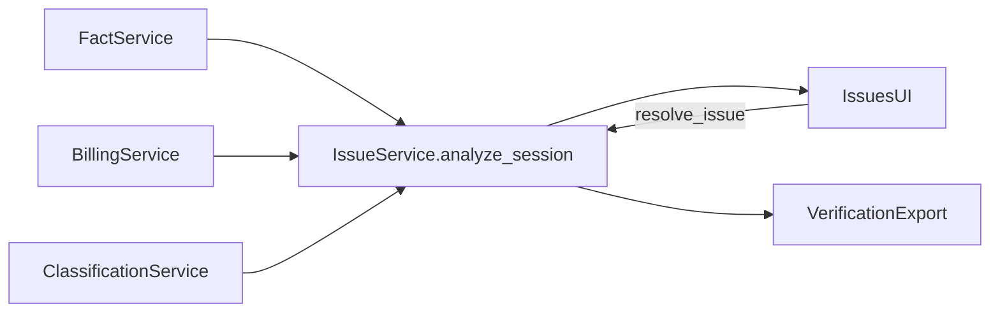
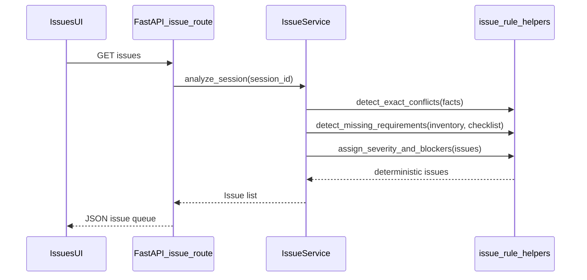
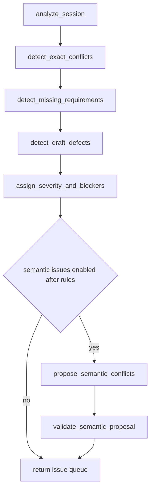
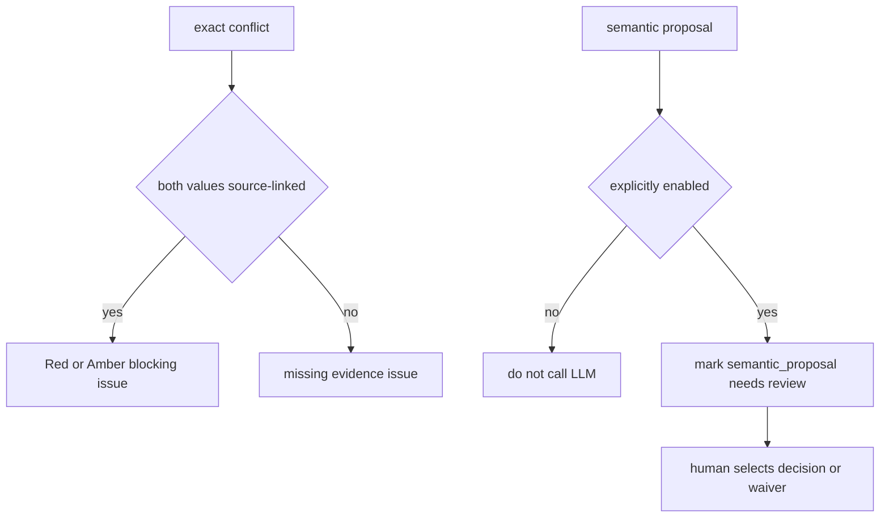

# 07. Issue and Contradiction Engine

| Field | Value |
|-------|-------|
| Spec | §8.8 / Phase 7 |
| Service(s) | IssueService |
| Upstream | [05 Deterministic Fact Extraction](./05-deterministic-fact-extraction.md); [06 Chronology and Billing](./06-chronology-and-billing.md); classification and draft inputs |
| Downstream | Human review, demand generation, verification/preflight/export |
| Exit gate | Known planted contradictions and drafting defects surface with source links; no source is silently selected. |
| Status | design |
| Contracts | [`issue.md`](../contracts/entities/issue.md); [`issue-types.md`](../contracts/issue-types.md); [`IssueSeverity`](../contracts/enums.md) / [`IssueStatus`](../contracts/enums.md); [`fact.md`](../contracts/entities/fact.md) |

## 1. Purpose
Create actionable review issues from deterministic conflicts, missing requirements, document defects, and arithmetic/exhibit checks. Exact comparisons run in code first. A later optional LLM may suggest semantic conflicts only after deterministic issues exist; it never decides legal or medical truth.

## 2. Responsibilities
- Detect exact conflicts for identity, dates, claim/policy IDs, providers, amounts/totals, and treatment ranges.
- Evaluate configurable required-document/fact checklists and drafting/exhibit hygiene rules.
- Assign taxonomy type, severity, source evidence, recommended actions, and drafting/export block state.
- Optionally quarantine semantic proposals behind an explicit feature flag and human review.
- Upstream modules that speak of “review items” create **`Issue`** records (session SoT). There is no parallel persisted queue type; optional `ReviewItem` is only a UI projection of `Issue` (see [`docs/contracts/README.md`](../contracts/README.md)).
- Does not silently resolve conflicts, make legal/medical conclusions, or treat semantic LLM output as evidence or a final decision.

## 3. Inputs and outputs
| Input | Source | Use |
|---|---|---|
| Facts, timeline, ledger/reconciliations | Modules 05–06 | exact conflict and arithmetic checks |
| Document inventory/classifications | Module 04 | checklist and exhibit checks |
| Draft metadata/text, if present | DraftService | placeholder, pronoun, label checks |
| Checklist and LLM configuration | session settings | deterministic scope and optional semantic mode |

| Output | Consumer | Contents |
|---|---|---|
| `Issue` | Issues UI, verification/export | taxonomy, severity, blocker, evidence, options |
| `IssueResolution` | downstream services | selected decision, waiver, history |

| Side effect | Detail |
|---|---|
| Session-state mutation | Issue queue and lightweight decision history; no permanent DB. |
| Event | `issue.detected`, `issue.resolved`, `issue.semantic_proposed`. |

## 4. Functional requirements
| FR | Acceptance note |
|---|---|
| FR-ISS-01 | `detect_exact_conflicts()` compares normalized values in code before any semantic processing. |
| FR-ISS-02 | `detect_missing_requirements()` uses a session-configurable checklist. |
| FR-ISS-03 | `detect_draft_defects()` checks placeholders, internal notes, pronouns, party labels, arithmetic, and exhibits. |
| FR-ISS-04 | `propose_semantic_conflicts()` is optional, runs after rules, and is not needed for extraction MVP. |
| FR-ISS-05 | Every issue has severity, explanation, sources, suggested actions, and a drafting/export blocker flag. |
| FR-ISS-06 | Semantic output is a proposal/options only; human review remains the final legal/medical decision. |

**Issue taxonomy:** Use dotted `issue_type` values from [`docs/contracts/issue-types.md`](../contracts/issue-types.md) (e.g. `billing.unreconciled_balance`, `extraction.unreadable_page`). Do not use undotted Appendix B short names as machine codes.

## 5. Proposed design (classes, methods, functions)
All names in this section are **proposed design** until implemented.

### 5.1 Types / models
- `Issue` — [`entities/issue.md`](../contracts/entities/issue.md); `issue_type` from [`issue-types.md`](../contracts/issue-types.md).
- `IssueSeverity`, `IssueStatus` — [`enums.md`](../contracts/enums.md). Prefer `blocking` on the Issue entity over separate `blocks_drafting`/`blocks_export` forks unless both map to that field.
- Module-local: `IssueResolution` payload maps to `Issue.resolution` + [`UserDecision`](../contracts/entities/user-decision.md) when recorded via module 08.

### 5.2 Service API (method list with signatures)
| Proposed method | Called by | Calls | FR | Failure modes |
|---|---|---|---|---|
| `analyze_session(session_id: str) -> list[Issue]` | process stage / Issues UI | exact, checklist, draft, arithmetic rules | 01–05 | Partial inputs produce specific missing-data issues |
| `detect_exact_conflicts(facts: list[Fact]) -> list[Issue]` | `analyze_session` | `compare_normalized_values`, `build_issue` | 01, 05 | Source-less candidate cannot create hidden resolution |
| `detect_missing_requirements(inventory, checklist) -> list[Issue]` | `analyze_session` | `check_required_items` | 02, 05 | Invalid checklist is configuration error |
| `propose_semantic_conflicts(session_id: str) -> list[Issue]` | optional post-rule stage | `build_semantic_prompt`, schema validation | 04–06 | Disabled/schema failure produces no proposal and preserves rules |
| `resolve_issue(session_id: str, resolution: IssueResolution) -> Issue` | resolve route | `validate_resolution` | 05–06 | Requires user decision; waivers remain visible |

### 5.3 Helpers / pure functions
- `compare_normalized_values`, `detect_treatment_range_conflicts`, `detect_arithmetic_defects`
- `check_required_items`, `detect_placeholders`, `detect_internal_comments`, `detect_pronoun_mismatch`, `detect_exhibit_mismatch`
- `assign_severity_and_blockers`, `build_issue`, `validate_resolution`, `validate_semantic_proposal`

### 5.4 API endpoints (if any)
- `GET /api/v1/sessions/{session_id}/issues`
- `POST /api/v1/sessions/{session_id}/issues/{issue_id}/resolve`
- Proposed internal-only semantic stage is invoked after deterministic analysis and is disabled unless explicitly enabled.

## 6. Detailed flows
### 6.1 Context diagram (Mermaid)


### 6.2 End-to-end sequence (Mermaid sequenceDiagram)


### 6.3 Internal algorithm (Mermaid flowchart) down to method calls


### 6.4 Error / edge-case flow (Mermaid)


## 7. Data contracts

**Contracts SoT:** [`docs/contracts/`](../contracts/README.md). **If this prose conflicts with `docs/contracts/`, contracts win.**

| Contract | Link |
|----------|------|
| Issue | [entities/issue.md](../contracts/entities/issue.md) |
| issue_type catalog | [issue-types.md](../contracts/issue-types.md) |
| IssueSeverity / IssueStatus | [enums.md](../contracts/enums.md) |
| Fact | [entities/fact.md](../contracts/entities/fact.md) |

Illustrative JSON (fields from contracts):

```json
{
  "id": "issue_01JEXAMPLE0000000000000D1",
  "session_id": "ses_01JEXAMPLE000000000000000",
  "issue_type": "billing.unreconciled_balance",
  "severity": "red",
  "title": "Unreconciled balance",
  "explanation": "Reported balance does not equal charges minus payments and adjustments.",
  "source_span_ids": ["span_90", "span_91"],
  "fact_ids": ["fact_41", "fact_42"],
  "options": ["Review ledger source", "Confirm correct balance"],
  "blocking": true,
  "status": "open",
  "resolution": null
}
```

## 8. UI touchpoints
The Issues panel sorts by severity, category, blocker, and document; shows title, explanation, evidence, and suggested action; and opens side-by-side sources for conflicts. Resolving or waiving an issue records the user's decision. Red blockers are exposed to demand/export controls. Semantic proposals are visually distinguished from deterministic issues.

## 9. Testing and exit gate
- Unit: exact comparator equivalence, checklist evaluation, taxonomy mapping, blocker policy, pronoun/placeholder/exhibit rules, and semantic schema rejection.
- Integration: facts/ledger/documents produce code-first issues; resolution updates downstream block state; disabled semantic configuration makes no LLM call.
- Golden: Amini known contradictions plus Ahmed/Morris/Fuentes pronoun, RE/salutation, and placeholder fixtures are detected with correct spans.
- Exit: planted defects and contradictions are source-linked and resolvable without silently accepting a competing value.

## 10. Open questions / non-goals
- Severity/blocker policies need attorney-approved configuration; taxonomy does not itself supply legal conclusions.
- The checklist is session-configurable, not a permanent rules database.
- Semantic LLM analysis is deferred/optional and cannot resolve fracture, causation, recovery, or damages questions.
