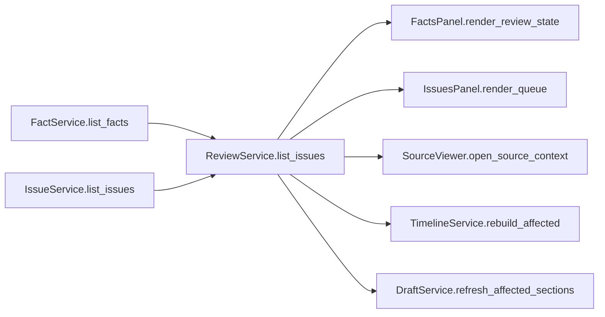
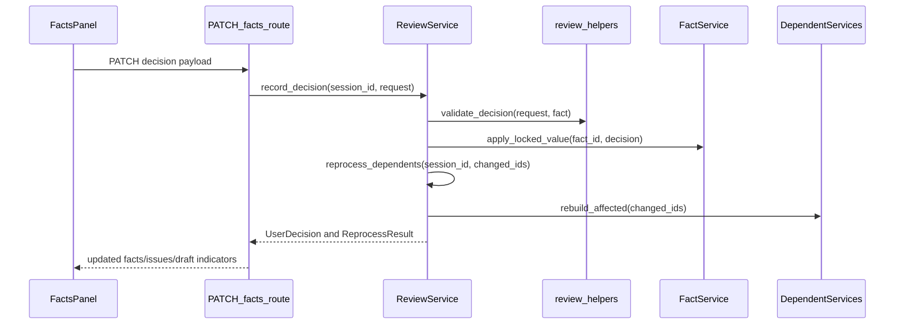
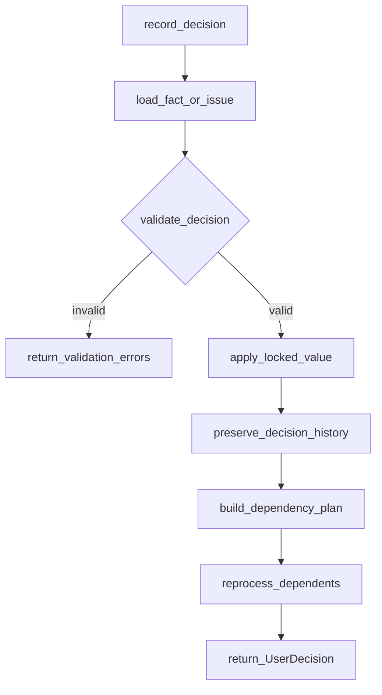
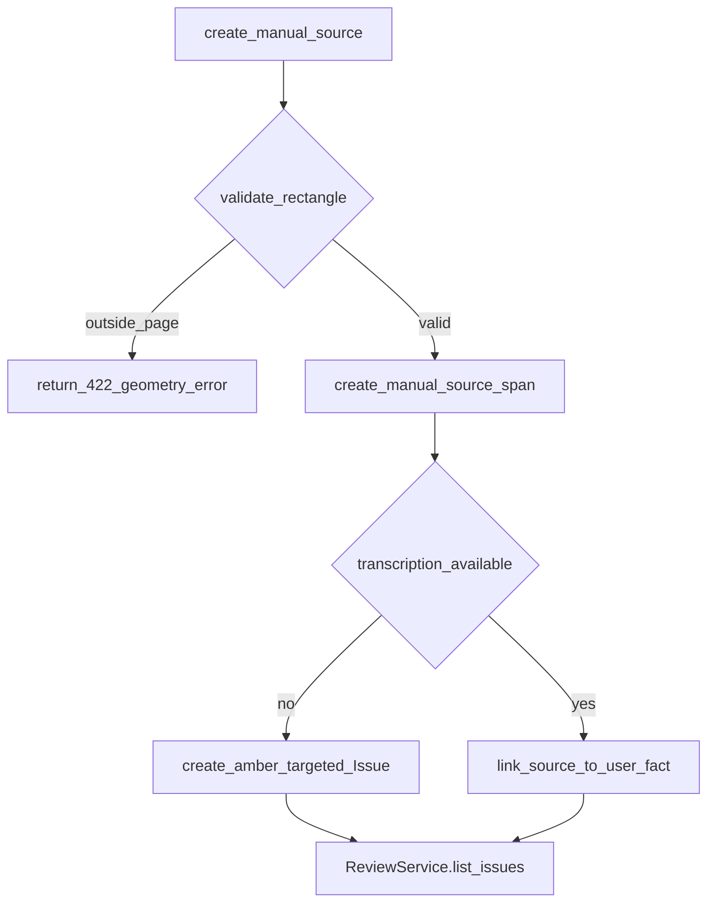

# 08. Human Review and Manual Intervention

| Field | Value |
|-------|-------|
| Spec | §8.9, §11 / Phase 7 |
| Service(s) | Proposed `ReviewService`; `FactService`, `IssueService`, `TimelineService`, `BillingService`, `DraftService` |
| Upstream | 05 Deterministic Fact Extraction; 06 Chronology and Billing; 07 Issue and Contradiction Engine |
| Downstream | 09 Demand Generation; 10 Verification, Preflight, and Export |
| Exit gate | A user resolves an unreadable handwritten value and semantic contradiction in the workspace; dependent outputs update correctly. |
| Status | design |
| Contracts | [`user-decision.md`](../contracts/entities/user-decision.md); [`DecisionAction`](../contracts/enums.md); [`fact.md`](../contracts/entities/fact.md); [`issue.md`](../contracts/entities/issue.md); [`source-span.md`](../contracts/entities/source-span.md); [`ReviewState`](../contracts/enums.md) / [`FactStatus`](../contracts/enums.md); [`ui-notes.md`](./ui-notes.md) |

## 1. Purpose
This module is the evidence-first intervention boundary: it presents uncertainty and conflicts, records an attributable user decision, and reruns only outputs affected by that decision. It never silently converts an uncertain extraction into an approved fact.

## 2. Responsibilities
- Own the Green, Amber, and Red review queue, decision capture, audit record, and manual source creation.
- Navigate a fact or issue to its canonical PDF.js page and highlight overlay.
- Preserve extracted value, user value, reason, source, and lock state.
- Trigger dependency-scoped recalculation after a decision; it does not redo unrelated OCR.
- Does not extract facts, decide legal/medical truth, or generate prose.

## 3. Inputs and outputs
| Inputs | Source |
|---|---|
| Facts, confidence, source spans, locks | FactService |
| Open issues, severity, options, blockers | IssueService |
| User action, value, reason, waiver, rectangle | Facts/Issues panel and Source Viewer |

| Outputs | Consumer |
|---|---|
| Approved/rejected/unavailable/deferred fact state | DraftService, VerificationService |
| `UserDecision` audit record and remaining blockers | Issue Panel, preflight |
| Manual source span linked to a fact | Fact Panel, Source Viewer |
| Scoped invalidation event | TimelineService, BillingService, IssueService, DraftService |

| Side effects | Rule |
|---|---|
| Session-memory mutations and `review.decision.recorded` event | Session-only; cleanup occurs with the case session |
| Highlight rectangle | Stored as a source-span geometry, never a local file path |

## 4. Functional requirements
| FR | Acceptance note |
|---|---|
| FR-REV-01 | Queue and facts display Green (high-confidence/valid), Amber (confirmation requested), and Red (blocking conflict, critical low confidence, illegible, or invalid). |
| FR-REV-02 | Selecting any fact or issue opens its document/page and all associated highlight regions. |
| FR-REV-03 | User can Use value, Enter different value, Exclude, Mark unavailable, or Defer to attorney; required reason rules are enforced. |
| FR-REV-04 | A dragged rectangle becomes a `manual` source span that can support a user-entered fact. |
| FR-REV-05 | Decision history retains original extraction, chosen value, reason, actor action, and source IDs. |
| FR-REV-06 | Reprocessing respects `locked=True`; automatic services cannot overwrite a locked fact. |
| FR-REV-07 | Dependency traversal reruns only affected calculations, summaries, issues, and draft sections. |

## 5. Proposed design (classes, methods, functions)
All names below are **proposed design** until implemented.

### 5.1 Types / models
- `ReviewState`, `DecisionAction`, `FactStatus` — [`enums.md`](../contracts/enums.md).
- `UserDecision` — [`entities/user-decision.md`](../contracts/entities/user-decision.md).
- `Fact` / `Issue` / `SourceSpan` — respective entity contracts; fact status after approval is `verified` or `locked` (never a non-enum `"approved"`).
- Session queue SoT is **`Issue`**. Optional `ReviewItem` is only a thin UI projection of `Issue` (same `issue_` ids) — see [Derived / ephemeral types](../contracts/README.md).
- Module-local: `ManualSourceRequest`, `DecisionRequest`, `SourceContext`, `ReprocessResult`, `DependencyPlan`.
- UX copy/recovery: [`ui-notes.md`](./ui-notes.md).

### 5.2 Service API (method list with signatures)
| Proposed method | Called by / calls | FR | Failure modes |
|---|---|---|---|
| `ReviewService.list_issues(session_id: str) -> list[Issue]` | `GET /issues`; may decorate with `derive_review_state()` for UI | 01 | Missing session; stale reference |
| `ReviewService.get_source_context(session_id: str, target_id: str) -> SourceContext` | fact/issue click; calls `collect_source_spans()` | 02 | Missing/deleted span returns visible error |
| `ReviewService.record_decision(session_id: str, request: DecisionRequest) -> UserDecision` | `PATCH /facts/{id}` or issue resolve; calls `validate_decision()`, `apply_locked_value()` | 03,05,06 | Invalid action, missing required value/reason, locked conflict |
| `ReviewService.create_manual_source(session_id: str, request: ManualSourceRequest) -> SourceSpan` | `POST /source-spans/manual`; calls `validate_rectangle()` | 04 | Out-of-page geometry, missing document/page |
| `ReviewService.reprocess_dependents(session_id: str, changed_ids: set[str]) -> ReprocessResult` | after decision; calls `build_dependency_plan()` and dependent services | 07 | Dependent calculation failure becomes Red `Issue`; no full OCR retry |

### 5.3 Helpers / pure functions
- `derive_review_state(confidence, critical, conflicts, valid_format) -> ReviewState`
- `validate_decision(request, fact) -> list[ValidationError]`
- `validate_rectangle(bounds, page_size) -> Rectangle`
- `build_dependency_plan(changed_fact_ids, graph) -> DependencyPlan`
- `preserve_decision_history(fact, decision) -> Fact`

### 5.4 API endpoints (if any)
`GET /api/v1/sessions/{session_id}/facts`, `PATCH /api/v1/sessions/{session_id}/facts/{fact_id}`, `GET /api/v1/sessions/{session_id}/issues`, `POST /api/v1/sessions/{session_id}/issues/{issue_id}/resolve`, and `POST /api/v1/sessions/{session_id}/source-spans/manual`.

## 6. Detailed flows
### 6.1 Context diagram (Mermaid)


### 6.2 End-to-end sequence (Mermaid sequenceDiagram)


### 6.3 Internal algorithm (Mermaid flowchart) down to method calls


### 6.4 Error / edge-case flow (Mermaid)


## 7. Data contracts

**Contracts SoT:** [`docs/contracts/`](../contracts/README.md). **If this prose conflicts with `docs/contracts/`, contracts win.**

| Contract | Link |
|----------|------|
| UserDecision | [entities/user-decision.md](../contracts/entities/user-decision.md) |
| DecisionAction / ReviewState / FactStatus | [enums.md](../contracts/enums.md) |
| Fact | [entities/fact.md](../contracts/entities/fact.md) |
| Issue | [entities/issue.md](../contracts/entities/issue.md) |
| SourceSpan (manual) | [entities/source-span.md](../contracts/entities/source-span.md) |
| UI notes | [ui-notes.md](./ui-notes.md) |

Illustrative decision + fact after review (fields from contracts):

```json
{
  "id": "dec_01JEXAMPLE0000000000000I1",
  "session_id": "ses_01JEXAMPLE000000000000000",
  "target_type": "fact",
  "target_id": "fact_102",
  "action": "enter_value",
  "old_value": "illegible",
  "new_value": "ABC-123",
  "reason": "Confirmed against original card",
  "timestamp": "2026-07-18T12:00:00Z",
  "actor_role": "paralegal"
}
```

```json
{
  "id": "fact_102",
  "status": "locked",
  "raw_value": "ABC-123",
  "normalized_value": "ABC-123",
  "source_span_ids": ["span_9", "span_manual_01"],
  "provenance": "user"
}
```

Manual source spans use `method` / extraction path `manual` on [`SourceSpan`](../contracts/entities/source-span.md) with normalized rectangle geometry.

## 8. UI touchpoints
The workspace uses Documents, Facts, Timeline & Billing, Issues, and Source Viewer panels. Facts show status/value/confidence/source/conflict counts and allow edits plus locking. Issues sort by severity/blocker and offer side-by-side conflicting evidence. The Source Viewer uses PDF.js, exact overlays, and a drag rectangle for manual sources; an unreadable handwritten field remains a targeted question, not guessed text.

## 9. Testing and exit gate
- Unit: `derive_review_state`, decision validation, rectangle bounds, locked-fact protection, and dependency-plan closure.
- Integration: resolve a date conflict and verify chronology labels, exact conflict rules, header fields, and only affected draft sentences refresh—without OCR of unrelated pages.
- Golden: use `docs/example/` to resolve an unreadable handwritten value and semantic contradiction, preserving all sources and audit values.
- Exit gate: the §8.9 gate is met and unresolved Red items remain blocking unless explicitly attorney-waived.

## 10. Open questions / non-goals
- Non-goal: automatic legal/medical adjudication or silently selecting a conflicting source.
- Non-goal: reprocessing whole documents for a local decision.
- Non-goal: persistent database/audit store beyond the prototype session.
- Open question: attorney-waiver permissions and required waiver reason are product-policy decisions.
