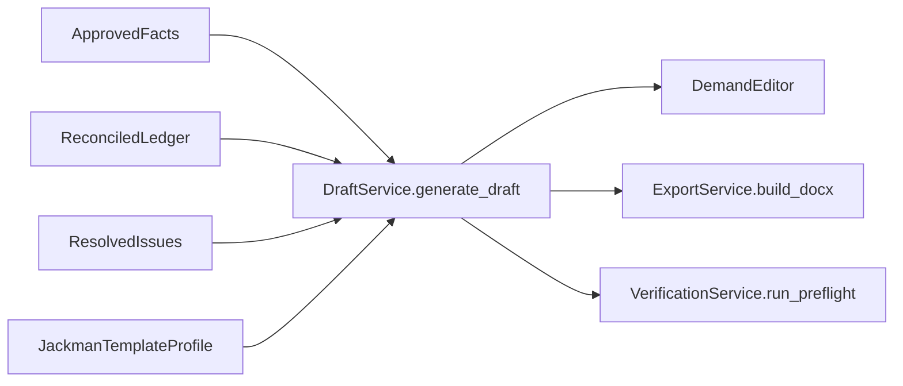
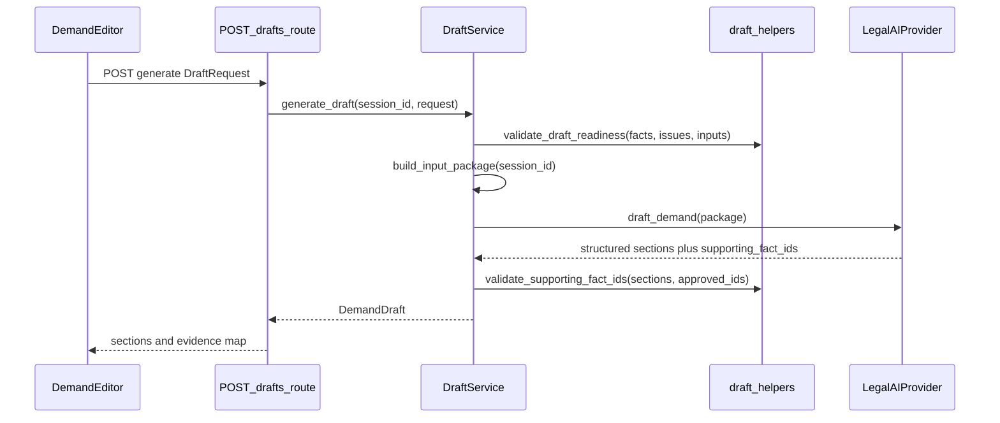
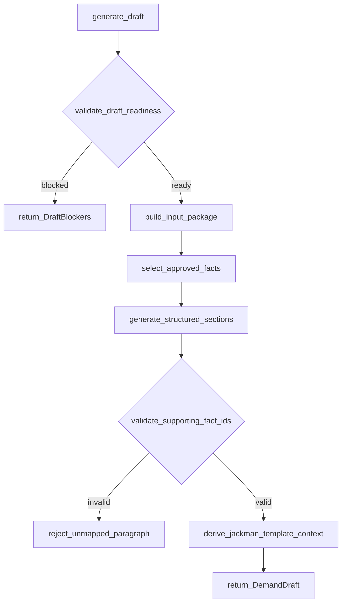
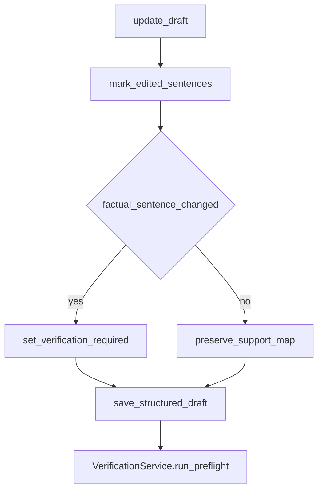

# 09. Demand Generation

| Field | Value |
|-------|-------|
| Spec | §8.10, §12 / Phase 8 |
| Service(s) | Proposed `DraftService`; optional `LegalAIProvider.draft_demand` |
| Upstream | 06 Chronology and Billing; 07 Issue and Contradiction Engine; 08 Human Review and Manual Intervention |
| Downstream | 10 Verification, Preflight, and Export |
| Exit gate | Draft uses only approved facts, follows the selected template, and every case-specific paragraph opens its evidence. |
| Status | design |
| Contracts | [`draft-section.md`](../contracts/entities/draft-section.md); [`fact.md`](../contracts/entities/fact.md); [`DraftSectionType`](../contracts/enums.md); [`draft.*`](../contracts/issue-types.md) |

## 1. Purpose
This module produces an editable, evidence-linked demand from approved facts and firm-controlled content. Evidence precedes prose: raw uploads and unresolved facts are never drafting context, and the first complete deliverable is a DOCX generated through `docxtpl`.

## 2. Responsibilities
- Check draft readiness and assemble the §12.1 approved input package.
- Produce structured sections and paragraph-to-fact links with `supporting_fact_ids`.
- Support required sections: header/re line, facts, liability, provider treatment, general damages, specials, settlement proposal, closing, and exhibits.
- Populate the Jackman-style firm template through `docxtpl` first; TipTap editing is secondary after mapping is proven.
- Preserve mapping while users edit and flag edited factual sentences for verification.
- Does not draft from full document text, approve facts, or make legal/medical decisions.

## 3. Inputs and outputs
| Inputs | Source |
|---|---|
| Approved identity, liability, medical, damages, correspondence facts | Review/FactService |
| Approved chronology, provider summaries, reconciled billing and confirmed specials | TimelineService, BillingService |
| Resolved issues, qualifications, demand amount, deadline | ReviewService |
| Firm template, approved clauses, exhibit rules, Jackman style | Template configuration |

| Outputs | Consumer |
|---|---|
| `DemandDraft`, ordered sections, paragraphs, support map | Demand Editor, VerificationService |
| DOCX-ready template context | ExportService |
| `verification_required` sentence markers | Preflight |

| Side effects | Rule |
|---|---|
| Session draft and paragraph map | Session-only; no raw uploads copied into prompt/context |
| Draft events | `draft.generated` and `draft.updated` |

## 4. Functional requirements
| FR | Acceptance note |
|---|---|
| FR-DRF-01 | `validate_draft_readiness()` requires minimum facts and resolved critical identity/liability conflicts before generation. |
| FR-DRF-02 | Only approved facts plus approved clauses/template content may enter `DraftInputPackage`; raw full-document text is excluded. |
| FR-DRF-03 | Each generated case-specific paragraph has nonempty `supporting_fact_ids`. |
| FR-DRF-04 | Builder supports every §8.10 required section and firm-selected ordering. |
| FR-DRF-05 | User edits retain paragraph-to-fact mapping; unchanged supports remain visible. |
| FR-DRF-06 | `mark_edited_sentences()` marks factual edits as verification-required. |

## 5. Proposed design (classes, methods, functions)
All names below are **proposed design** until implemented.

### 5.1 Types / models
- `DraftSection` / nested `DraftParagraph` — [`entities/draft-section.md`](../contracts/entities/draft-section.md); `DraftSectionType` in [`enums.md`](../contracts/enums.md).
- Module-local packaging (illustrative, not separate SoT files): `DemandDraft` (ordered sections + template_id + status), `DraftInputPackage`, `TemplateProfile`, `DraftRequest`, `DraftPatch`, `DraftBlocker`.
- “Approved” facts for drafting means `FactStatus` in (`verified`, `edited`, `locked`) per [`enums.md`](../contracts/enums.md) — not a separate status string.

### 5.2 Service API (method list with signatures)
| Proposed method | Called by / calls | FR | Failure modes |
|---|---|---|---|
| `DraftService.generate_draft(session_id: str, request: DraftRequest) -> DemandDraft` | `POST /drafts`; calls readiness/package/section generation | 01–04 | Readiness blocker, absent template, provider schema failure |
| `DraftService.build_input_package(session_id: str) -> DraftInputPackage` | generation; calls `select_approved_facts()` | 02 | Non-approved/raw fact detected |
| `DraftService.generate_structured_sections(package: DraftInputPackage) -> list[DraftSection]` | generation; calls `LegalAIProvider.draft_demand()` when enabled or deterministic/template assembly | 03,04 | Missing support IDs, invalid response |
| `DraftService.update_draft(session_id: str, draft_id: str, patch: DraftPatch) -> DemandDraft` | `PATCH /drafts/{id}`; calls `mark_edited_sentences()` | 05,06 | Unknown paragraph or broken mapping |
| `DraftService.build_docx_context(draft: DemandDraft) -> dict` | ExportService; calls `validate_paragraph_support()` | 02–04 | Unsupported paragraph rejected |

### 5.3 Helpers / pure functions
- `validate_draft_readiness(facts, issues, user_inputs) -> list[DraftBlocker]`
- `select_approved_facts(facts) -> list[Fact]`
- `validate_supporting_fact_ids(paragraph, approved_ids) -> list[ValidationError]`
- `mark_edited_sentences(before, after) -> list[SentenceSupport]`
- `derive_jackman_template_context(sections) -> dict`

### 5.4 API endpoints (if any)
`POST /api/v1/sessions/{session_id}/drafts` generates a structured draft; `PATCH /api/v1/sessions/{session_id}/drafts/{draft_id}` saves structured edits. Template population is consumed internally by ExportService rather than exposed as a raw-template endpoint.

## 6. Detailed flows
### 6.1 Context diagram (Mermaid)


### 6.2 End-to-end sequence (Mermaid sequenceDiagram)


### 6.3 Internal algorithm (Mermaid flowchart) down to method calls


### 6.4 Error / edge-case flow (Mermaid)


## 7. Data contracts

**Contracts SoT:** [`docs/contracts/`](../contracts/README.md). **If this prose conflicts with `docs/contracts/`, contracts win.**

| Contract | Link |
|----------|------|
| DraftSection / DraftParagraph | [entities/draft-section.md](../contracts/entities/draft-section.md) |
| DraftSectionType / StatementSupportLabel | [enums.md](../contracts/enums.md) |
| Fact (approved inputs) | [entities/fact.md](../contracts/entities/fact.md) |
| Draft issue types | [issue-types.md](../contracts/issue-types.md) (`draft.*`) |

Illustrative readiness package (module-local; amounts as decimal strings):

```json
{
  "minimum_fact_ids": ["fact_client", "fact_claim", "fact_loss_date"],
  "approved_fact_ids": ["fact_102", "fact_118"],
  "unresolved_red_issue_ids": [],
  "template_id": "jackman_demand_v1",
  "demand_amount": "50000.00",
  "offer_deadline": "2026-08-01"
}
```

Illustrative paragraph (fields from `DraftParagraph`):

```json
{
  "id": "para_1",
  "text": "Treatment began after the collision.",
  "supporting_fact_ids": ["fact_118"],
  "contains_argument": false,
  "verification_required": false,
  "support_label": "supported"
}
```

## 8. UI touchpoints
The Demand screen presents firm-order sections, source support at paragraph/sentence level, and click-through to facts and source documents. Template-controlled clauses are distinguishable in review mode but not exported. `docxtpl` download is the primary complete path. TipTap is secondary: it may edit structured prose only after paragraph-to-fact mapping works, and factual edits visibly become verification-required.

## 9. Testing and exit gate
- Unit: readiness blocking, approved-fact filtering, support-ID validation, Jackman template context, and factual sentence diffing.
- Integration: attempt generation with a Red identity/liability issue (blocked), then resolve it and generate a complete ordered draft.
- Golden: generate from `docs/example/`; assert no raw-document phrase is used as an unapproved fact and every case-specific paragraph opens existing evidence.
- DOCX: render the Jackman-derived `docxtpl` template; verify section order, specials table, exhibits, and placeholders are available to preflight.
- Exit gate: the §8.10 gate is met; only approved evidence supports case prose.

## 10. Open questions / non-goals
- Non-goal: generation from raw PDFs, raw page dumps, or unapproved candidates.
- Non-goal: treating model prose as evidence; supporting fact IDs are mandatory.
- Non-goal: TipTap as a prerequisite for MVP drafting.
- Open question: whether approved narrative is deterministic/template assembled, LLM drafted, or both remains a controlled implementation choice; both must obey the same package and support contract.
