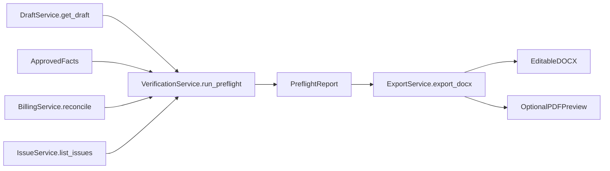
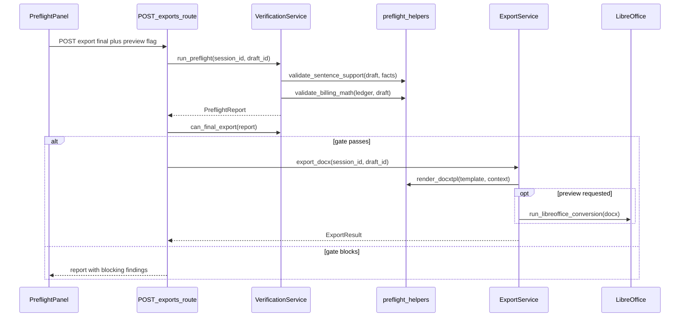
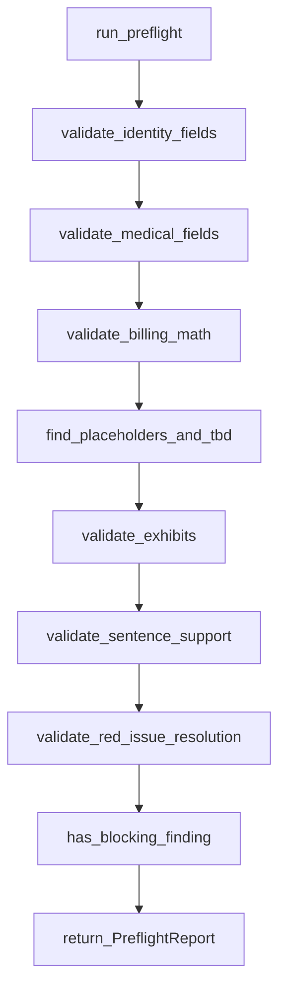
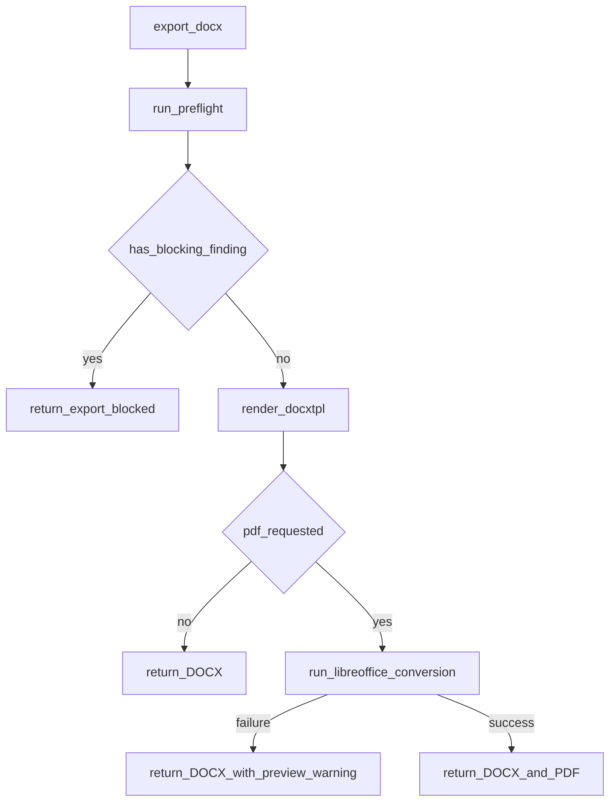

# 10. Verification, Preflight, and Export

| Field | Value |
|-------|-------|
| Spec | §8.11, §12 / Phase 9 |
| Service(s) | Proposed `VerificationService`, `ExportService`; optional `LegalAIProvider.verify_draft` |
| Upstream | 08 Human Review and Manual Intervention; 09 Demand Generation |
| Downstream | Final editable DOCX download; optional PDF preview |
| Exit gate | Refuse export for a known placeholder, math error, unsupported factual sentence, or unresolved Red issue. Semantic-verifier errors cannot turn a failed programmatic gate into a pass. |
| Status | design |
| Contracts | [`preflight-report.md`](../contracts/entities/preflight-report.md); [`export-result.md`](../contracts/entities/export-result.md); [`StatementSupportLabel`](../contracts/enums.md) / [`FindingSeverity`](../contracts/enums.md) / [`ExportKind`](../contracts/enums.md); export codes in [`error-codes.md`](../contracts/error-codes.md) |

## 1. Purpose
This module is the final evidence and hygiene gate. Programmatic preflight is the reliable authority: optional semantic verification can add findings but cannot make a defective draft exportable. Final deliverable is editable DOCX; PDF is an optional preview conversion.

## 2. Responsibilities
- Validate identity, claim, medical, billing, draft hygiene, exhibits, support, and user decisions programmatically.
- Combine findings into a source-linked preflight report and block final export for §8.11 conditions.
- Optionally request independent semantic labels: Supported, Partially Supported, Unsupported, Contradicted, Legal Clause, or Argument.
- Populate the firm template and emit editable `.docx`; optionally invoke LibreOffice for PDF preview.
- Does not replace programmatic decisions with semantic-model output or alter source evidence.

## 3. Inputs and outputs
| Inputs | Source |
|---|---|
| Structured draft and paragraph/fact map | DraftService |
| Approved facts, Red waivers, issue status | ReviewService, IssueService |
| Timeline, billing reconciliation, exhibits, template | TimelineService, BillingService, session |

| Outputs | Consumer |
|---|---|
| `PreflightReport` and source-linked findings | Preflight UI, Demand Editor |
| `ExportResult` containing DOCX and optional preview PDF | Download endpoint |
| Blocking status | Final export control |

| Side effects | Rule |
|---|---|
| Session temporary DOCX/PDF artifacts | Delete during session cleanup; never expose local paths |
| `draft.preflight.completed`, `export.created` events | Events contain opaque IDs and status only |

## 4. Functional requirements
| FR | Acceptance note |
|---|---|
| FR-VAL-01 | Code validates names, pronouns, dates, claim/policy values, providers, service ranges, counts, totals, exhibits, and placeholders. |
| FR-VAL-02 | Optional independent semantic verifier labels each statement; its imperfect result never supersedes programmatic gate. |
| FR-VAL-03 | Final export is blocked for unsupported facts, unresolved critical issues, invalid calculations, or placeholders; known TBD/Red conditions block. |
| FR-VAL-04 | Preflight report links every finding to affected draft text and available source evidence. |
| FR-EXP-01 | Populate firm template and return editable DOCX. |
| FR-EXP-02 | PDF conversion is optional preview only; DOCX remains primary. |

## 5. Proposed design (classes, methods, functions)
All names below are **proposed design** until implemented.

### 5.1 Types / models
- `PreflightFinding` / `PreflightReport` — [`entities/preflight-report.md`](../contracts/entities/preflight-report.md).
- `ExportResult` / `ExportArtifact` — [`entities/export-result.md`](../contracts/entities/export-result.md).
- `FindingSeverity`, `ExportKind`, `StatementSupportLabel` — [`enums.md`](../contracts/enums.md).
- Finding `code` values prefer [`issue-types.md`](../contracts/issue-types.md) plus preflight-only codes listed on the preflight entity.
- API refusals: `export_blocked_preflight`, `export_blocked_red_issues`, `export_failed` in [`error-codes.md`](../contracts/error-codes.md).

### 5.2 Service API (method list with signatures)
| Proposed method | Called by / calls | FR | Failure modes |
|---|---|---|---|
| `VerificationService.run_preflight(session_id: str, draft_id: str) -> PreflightReport` | verify route/export; calls category validators | 01,03,04 | Missing draft/map, invalid ledger becomes blocking finding |
| `VerificationService.verify_semantically(draft: DemandDraft) -> list[SemanticFinding]` | verify route when enabled; calls provider and validates labels | 02 | Provider/schema failure visible as warning; programmatic gate remains |
| `VerificationService.can_final_export(report: PreflightReport) -> bool` | ExportService; calls `has_blocking_finding()` | 03 | False for TBD, Red, unsupported, math, placeholder |
| `ExportService.export_docx(session_id: str, draft_id: str) -> ExportResult` | `POST /exports`; calls preflight and `render_docxtpl()` | 01,03,05 | Final gate blocked, template/render error |
| `ExportService.convert_preview_pdf(docx_id: str) -> ExportArtifact` | optional export; calls `run_libreoffice_conversion()` | 06 | Conversion failure leaves valid DOCX available |

### 5.3 Helpers / pure functions
- `validate_identity_fields(draft, facts) -> list[PreflightFinding]`
- `validate_billing_math(ledger, draft) -> list[PreflightFinding]`
- `find_placeholders_and_tbd(text) -> list[PreflightFinding]`
- `validate_exhibits(draft, documents) -> list[PreflightFinding]`
- `validate_sentence_support(draft, approved_facts) -> list[PreflightFinding]`
- `has_blocking_finding(findings) -> bool`

### 5.4 API endpoints (if any)
`POST /api/v1/sessions/{session_id}/drafts/{draft_id}/verify` returns preflight; `POST /api/v1/sessions/{session_id}/exports` requests DOCX and optional PDF; `GET /api/v1/sessions/{session_id}/exports/{export_id}` downloads an artifact.

## 6. Detailed flows
### 6.1 Context diagram (Mermaid)

### 6.2 End-to-end sequence (Mermaid sequenceDiagram)

### 6.3 Internal algorithm (Mermaid flowchart) down to method calls

### 6.4 Error / edge-case flow (Mermaid)

## 7. Data contracts

**Contracts SoT:** [`docs/contracts/`](../contracts/README.md). **If this prose conflicts with `docs/contracts/`, contracts win.**

| Contract | Link |
|----------|------|
| PreflightReport / PreflightFinding | [entities/preflight-report.md](../contracts/entities/preflight-report.md) |
| ExportResult | [entities/export-result.md](../contracts/entities/export-result.md) |
| StatementSupportLabel / FindingSeverity / ExportKind | [enums.md](../contracts/enums.md) |
| DraftSection | [entities/draft-section.md](../contracts/entities/draft-section.md) |
| Export / draft error codes | [error-codes.md](../contracts/error-codes.md) |

See entity files for full illustrative JSON. Finding codes such as `draft.placeholder` and `support.unsupported_sentence` are defined on the preflight contract.

## 8. UI touchpoints
Preflight is the sixth primary screen. It groups source-linked findings by category and opens the affected draft sentence/fact/source. Final Export is disabled with blocking Red, TBD, placeholder, invalid-math, unresolved critical issue, or unsupported-fact findings. Draft Export may be offered only with noncritical warnings and a draft label. Download controls identify DOCX as the primary output and PDF as preview.

## 9. Testing and exit gate
- Unit: every category validator, placeholder/TBD detection, support matrix, arithmetic reconciliation, Red waiver rules, and gate truth table.
- Integration: inject each §8.11 blocker and assert `can_final_export()` is false, artifact creation does not occur, and the report links to draft/source.
- DOCX/PDF: render a valid firm template; run LibreOffice conversion when installed and verify conversion failure does not remove DOCX.
- Golden: use `docs/example/` to confirm provider totals, exhibits, and support map match approved evidence.
- Exit gate: §8.11 refusal conditions are demonstrated; semantic-verifier errors cannot turn a failed programmatic gate into a pass.

## 10. Open questions / non-goals
- Non-goal: exporting a final document with any unresolved reliable gate failure.
- Non-goal: treating optional semantic verification as authoritative over deterministic checks.
- Non-goal: PDF as the primary deliverable or mandatory runtime dependency; LibreOffice conversion is optional.
- Open question: final attorney confirmation workflow is policy/UI work; this module must receive an explicit confirmation signal if required.
