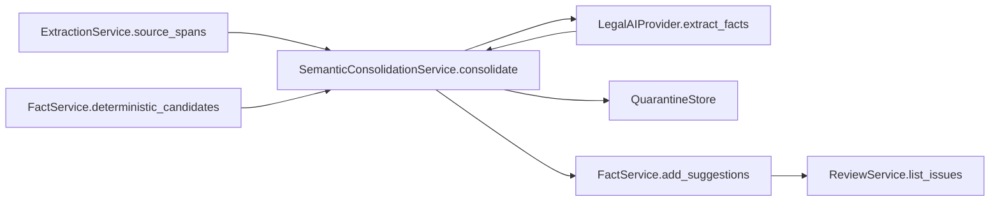
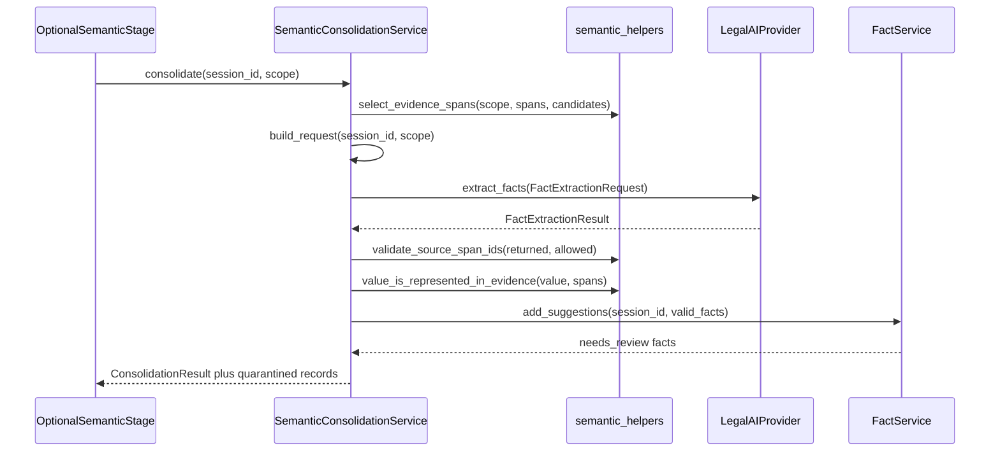
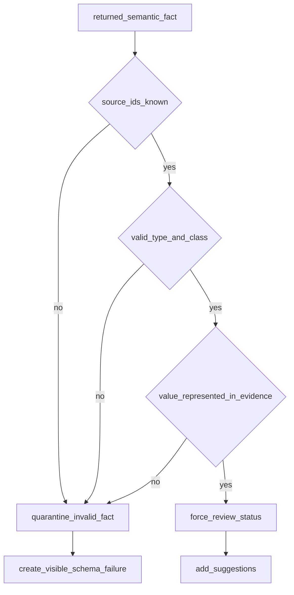

# 11. LLM Semantic Consolidation (Optional)

| Field | Value |
|-------|-------|
| Spec | §8.6, §10 / Phase 6 optional |
| Service(s) | Proposed optional `SemanticConsolidationService`; `FactService`; `LegalAIProvider.extract_facts` |
| Upstream | 03 Page Analysis and Text Extraction; 05 Deterministic Fact Extraction; 08 Human Review and Manual Intervention |
| Downstream | 06 Chronology and Billing; 07 Issue and Contradiction Engine; 08 Human Review; 09 Demand Generation |
| Exit gate | When enabled, schema-valid output has a real source for every accepted fact; unsupported output never enters the evidence set. |
| Status | deferred / optional — **not required for MVP** |
| Contracts | [`fact.md`](../contracts/entities/fact.md); [`source-span.md`](../contracts/entities/source-span.md); [`fact-types.md`](../contracts/fact-types.md); [`FactStatus`](../contracts/enums.md) |

## 1. Purpose
This deferred module optionally consolidates selected, already-extracted evidence spans into semantic fact suggestions. It is not required for the extraction MVP: default v0.2 remains OCR, deterministic parsers, cross-document checks, and human review. It may never receive full original PDFs or entire page dumps to “extract everything.”

## 2. Responsibilities
- Select bounded source spans, document metadata, deterministic candidates, and schema—not whole PDFs—for a request.
- Call `LegalAIProvider.extract_facts()` only when the optional feature is enabled.
- Validate returned type, value/evidence representation, and existing `source_span_ids`; quarantine invalid proposals.
- Separate observed fact, provider opinion, patient report, legal allegation, and system inference.
- Group duplicate candidates while preserving supporting and conflicting sources.
- Set LLM facts to `suggested` or `needs_review`, especially for critical categories, until user confirmation.
- Does not replace deterministic extraction, invent source IDs, make final legal/medical decisions, or satisfy the MVP gate.

## 3. Inputs and outputs
| Inputs | Source |
|---|---|
| Selected source spans, page/document metadata | ExtractionService |
| Deterministic candidates and allowed fact types | FactService |
| Explicit response schema, request feature flag | Session configuration |

| Outputs | Consumer |
|---|---|
| Schema-valid semantic fact suggestions | FactService, ReviewService |
| Duplicate groups with supporting/conflicting source IDs | IssueService, Review UI |
| Quarantine records for invalid responses | Developer/review diagnostics |

| Side effects | Rule |
|---|---|
| Token/operation metadata and in-session result cache | Do not log full medical text unless explicitly debug-enabled on non-production test data |
| `fact.semantic.suggested` event | No event means approved evidence |

## 4. Functional requirements
| FR | Acceptance note |
|---|---|
| FR-AI-01 | Request includes selected spans, metadata, deterministic candidates, and explicit JSON schema only. |
| FR-AI-02 | Every returned fact cites IDs from the exact allowed `source_span_ids` set. |
| FR-AI-03 | Unknown IDs, invalid types, or values not represented in evidence are rejected/quarantined. |
| FR-AI-04 | Enabled schema covers symptoms, diagnoses, exam/imaging findings, treatment, medications, referrals, causation, recovery, restrictions, future care, prior conditions, and daily-life effects. |
| FR-AI-05 | Every proposal labels its evidence class: observed fact, provider opinion, patient report, legal allegation, or system inference. |
| FR-AI-06 | Duplicate consolidation retains all supporting and conflicting sources. |
| FR-AI-07 | All LLM semantic facts remain `suggested`/`needs_review`; critical categories require user confirmation. |

## 5. Proposed design (classes, methods, functions)
All names below are **proposed design** until implemented.

### 5.1 Types / models
- Validated semantic output **merges into** [`Fact`](../contracts/entities/fact.md) with `provenance: "llm_optional"` and `FactStatus` `suggested` or `needs_review` — not a parallel entity SoT.
- `fact_type` values must be dotted codes from [`fact-types.md`](../contracts/fact-types.md) (e.g. `medical.diagnosis`, not undotted `diagnosis`).
- Module-local: `FactExtractionRequest`, `QuarantinedSemanticFact`, `ConsolidationResult`, `SemanticScope`, `EvidenceClass` (`observed_fact` \| `provider_opinion` \| `patient_report` \| `legal_allegation` \| `system_inference`).
- Spans cited must already exist as [`SourceSpan`](../contracts/entities/source-span.md).

### 5.2 Service API (method list with signatures)
| Proposed method | Called by / calls | FR | Failure modes |
|---|---|---|---|
| `SemanticConsolidationService.consolidate(session_id: str, scope: SemanticScope) -> ConsolidationResult` | optional job stage; calls selection/provider/validation | 01–07 | Feature disabled, provider unavailable, visible failure |
| `SemanticConsolidationService.build_request(session_id: str, scope: SemanticScope) -> FactExtractionRequest` | consolidation; calls `select_evidence_spans()` | 01 | Oversized/unapproved/full-PDF context refused |
| `SemanticConsolidationService.validate_response(request: FactExtractionRequest, result: FactExtractionResult) -> ValidationOutcome` | consolidation; calls ID/type/value validators | 02,03,05,07 | Invalid results quarantined |
| `SemanticConsolidationService.consolidate_duplicates(facts: list[SemanticFact]) -> list[DuplicateGroup]` | post-validation; calls `preserve_conflicting_sources()` | 06 | Ambiguity remains reviewable, not merged silently |
| `FactService.add_suggestions(session_id: str, facts: list[SemanticFact]) -> list[Fact]` | after validation; calls `force_review_status()` | 04,07 | Never overwrites locked/approved facts |

### 5.3 Helpers / pure functions
- `select_evidence_spans(scope, spans, candidates) -> list[SourceSpan]`
- `validate_source_span_ids(returned_ids, allowed_ids) -> list[ValidationError]`
- `value_is_represented_in_evidence(value, spans) -> bool`
- `validate_fact_type_and_class(fact, schema) -> list[ValidationError]`
- `force_review_status(fact, critical_types) -> SemanticFactStatus`
- `preserve_conflicting_sources(group) -> DuplicateGroup`

### 5.4 API endpoints (if any)
No standalone MVP endpoint is required. If enabled, an internal optional processing stage invokes consolidation after deterministic extraction; facts remain visible through `GET /api/v1/sessions/{session_id}/facts` and are confirmed using the standard fact-review endpoint.

## 6. Detailed flows
### 6.1 Context diagram (Mermaid)


### 6.2 End-to-end sequence (Mermaid sequenceDiagram)


### 6.3 Internal algorithm (Mermaid flowchart) down to method calls
```mermaid
flowchart TD
  start[consolidate] --> enabled{feature_enabled}
  enabled -->|no| skip[return_skipped]
  enabled -->|yes| spans[select_evidence_spans]
  spans --> request[build_request]
  request --> call[LegalAIProvider.extract_facts]
  call --> schema[validate_fact_type_and_class]
  schema --> ids[validate_source_span_ids]
  ids --> evidence[value_is_represented_in_evidence]
  evidence --> status[force_review_status]
  status --> groups[consolidate_duplicates]
  groups --> done[return_ConsolidationResult]
```

### 6.4 Error / edge-case flow (Mermaid)


## 7. Data contracts

**Contracts SoT:** [`docs/contracts/`](../contracts/README.md). **If this prose conflicts with `docs/contracts/`, contracts win.**

| Contract | Link |
|----------|------|
| Fact (merged suggestions) | [entities/fact.md](../contracts/entities/fact.md) |
| fact_type catalog | [fact-types.md](../contracts/fact-types.md) |
| SourceSpan | [entities/source-span.md](../contracts/entities/source-span.md) |
| FactStatus | [enums.md](../contracts/enums.md) |

Illustrative request (module-local packaging; types from contracts):

```json
{
  "schema_version": "semantic-facts-v1",
  "allowed_source_span_ids": ["span_47", "span_52"],
  "document_metadata": [{"document_id": "doc_9", "page_number": 3}],
  "deterministic_candidates": [{"fact_id": "fact_202", "fact_type": "medical.provider", "value": "Example Clinic"}],
  "allowed_fact_types": ["medical.complaint", "medical.diagnosis", "medical.treatment", "medical.medication"]
}
```

Quarantine records are module-local diagnostics and must set `added_to_evidence_set: false`.

## 8. UI touchpoints
Semantic suggestions appear in Facts and Issues with origin/method, source count, evidence class, and `suggested`/`needs_review` state. They open the same source viewer highlights as deterministic facts but never display as approved without user action. Feature-disabled sessions show no semantic-extraction dependency; the normal OCR/deterministic/review workflow remains complete.

## 9. Testing and exit gate
- Unit: source-ID allowlist, evidence-value grounding, type/class validation, mandatory review state, duplicate/conflict preservation, and full-PDF request refusal.
- Integration: provider returns unknown IDs, invented value, invalid type, and a valid sourced fact; assert only valid fact becomes a review suggestion and all invalid outputs are quarantined.
- Contract: validate request/output Pydantic schema; retry once on schema validation error, then fail visibly without corrupting evidence.
- Golden: selected spans from `docs/example/` demonstrate every accepted semantic fact opens an existing region.
- Exit gate applies only when the feature is enabled. The extraction MVP is complete without this module; no LLM call is required to meet it.

## 10. Open questions / non-goals
- **Not required for MVP:** this module remains OPTIONAL/DEFERRED and disabled by default.
- Non-goal: sending a full PDF, full case corpus, or whole-page dump to an LLM for extraction.
- Non-goal: primary extraction of identity, claim, dates, money, codes, or exact conflicts.
- Non-goal: approving, locking, or overwriting a fact from model output.
- Open question: provider/model selection and operational consent controls are deferred until this optional capability is enabled.
