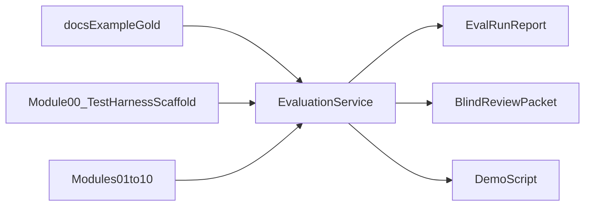
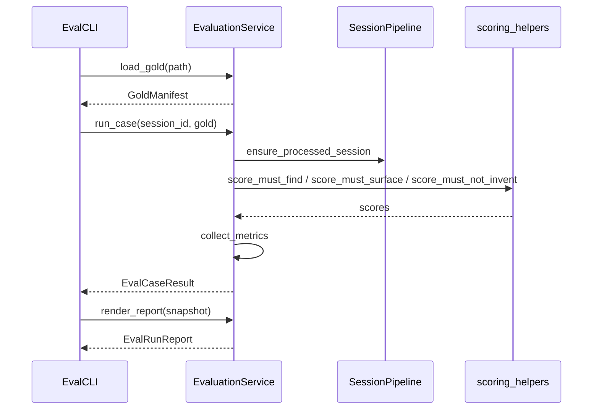
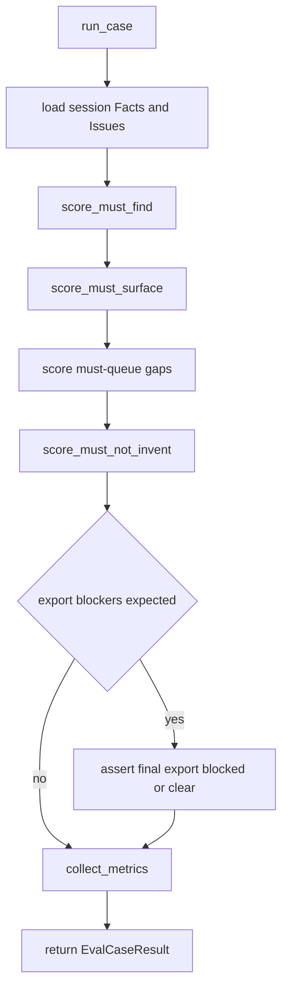
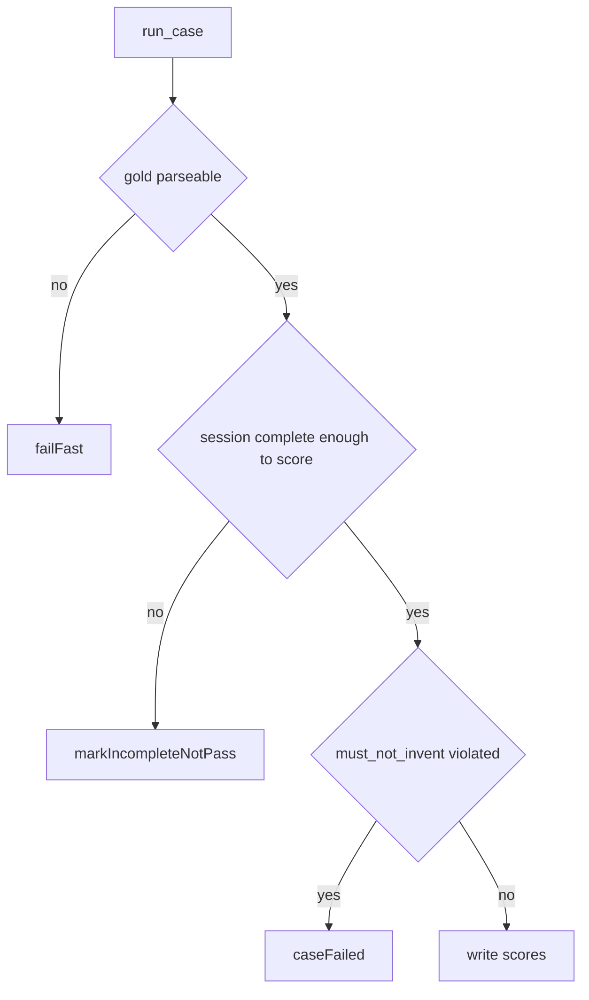

# 12. Evaluation Demonstration

| Field | Value |
|-------|-------|
| Spec | §17, §18 Phase 10 |
| Service(s) | Proposed `EvaluationService`, `GoldCorpusRunner`, metric reporters (Phase 0 `TestHarness` scaffold only) |
| Upstream | [00 Repository and Contracts](./00-repository-and-contracts.md) through [10 Verification, Preflight, and Export](./10-verification-preflight-and-export.md); optional [11 LLM Semantic Consolidation](./11-llm-semantic-consolidation-optional.md) |
| Downstream | Demo scripts, blind-review packets, stakeholder reports (no further product modules) |
| Exit gate | Results are repeatable and show where the prototype is faster, more traceable, or less error-prone than the current manual/chatbot workflow. |
| Status | design |
| Contracts | [`fact-types.md`](../contracts/fact-types.md); [`issue-types.md`](../contracts/issue-types.md); gold shape [`docs/example/gold/`](../example/gold/README.md); entities used in scoring (`Fact`, `Issue`, `PreflightReport`, `ExportResult`) via [`docs/contracts/`](../contracts/README.md) |

## 1. Purpose

Own Phase 10 evaluation: run gold answer keys against a session pipeline, collect §17.3 metrics, produce timing/traceability reports, assemble a blind-review packet, and support a demonstration script. This module does **not** redefine gold answer-key *shape* — that lives under [`docs/example/gold/`](../example/gold/README.md).

## 2. Responsibilities

- Load gold manifests (illustrative or firm-controlled copies of the gold template).
- Drive or replay a session through upload → extraction → issues → optional draft/preflight for scoring.
- Score must-find / must-surface / must-queue / must-not-invent / export-blocker criteria from gold files.
- Aggregate metrics (precision, recall, silent critical-error rate, source-link accuracy, timing).
- Emit a human-readable report and optional blind-review packet (system draft vs baseline, labels hidden).
- Does not own product OCR/parsers, invent gold truth, or treat `docs/example/` as the only real-world case shape.
- Does not require Module 11 (LLM optional path remains skippable for extraction MVP scoring).

## 3. Inputs and outputs

| Inputs | Source |
|---|---|
| Gold key Markdown / manifest | [`docs/example/gold/`](../example/gold/README.md) or firm-controlled copy |
| Session facts, issues, spans, preflight, export artifacts | Modules 01–10 |
| Baseline timing / error notes | Manual current-workflow capture (§17.4) |

| Outputs | Consumer |
|---|---|
| `EvalRunReport` (module-local) | Developers, demo stakeholders |
| Metric tables (§17.3) | Timing dashboard / Markdown or JSON report |
| Blind-review packet | Attorney reviewers |
| Demo script checklist | Live demonstration |

| Side effects | Rule |
|---|---|
| May create temporary eval sessions | Session-only; cleanup with session TTL / explicit delete |
| Must not log full medical text by default | Respect `LOG_DOCUMENT_TEXT=false` |

## 4. Functional requirements

Phase 10 realizes §17 evaluation rather than a dedicated §8 FR set.

| Mapping | Acceptance note |
|---|---|
| §17.0 | Critical field scored correct only with value+span **or** explicit Amber/Red queue — never silent wrong. |
| §17.1 | Unit/component/contract/integration already owned upstream; this module owns golden-corpus runner + report aggregation. |
| §17.2 | Gold keys distinguish objective facts from attorney judgment; Amini evidence primary; other DOCX as defect fixtures. |
| §17.3 | Report includes the metric table dimensions (classification, fact P/R, silent critical errors, source links, contradictions, billing, unsupported statements, corrections, timing). |
| §17.4 | Support side-by-side comparison workflow without feeding existing final demand into drafting unless FR-CLS-06 test. |
| §17.5 | Minimum acceptance checklist is the Phase 10 demo gate checklist. |
| Phase 10 exit | Results repeatable; clear where prototype is faster / more traceable / less error-prone. |

## 5. Proposed design (classes, methods, functions)

All interfaces below are **proposed design** until implemented.

### 5.1 Types / models

- Gold sections — shape from [`GOLD_CASE_TEMPLATE.md`](../example/gold/GOLD_CASE_TEMPLATE.md) (not a contracts entity).
- Scoring uses contracted [`Fact`](../contracts/entities/fact.md), [`Issue`](../contracts/entities/issue.md), [`PreflightReport`](../contracts/entities/preflight-report.md).
- Module-local: `GoldManifest`, `EvalCaseResult`, `EvalRunReport`, `MetricSnapshot`, `BlindReviewPacket`, `DemoScript`.

### 5.2 Service API (method list with signatures)

| Proposed method | Called by | Calls | FR / source | Failure modes |
|---|---|---|---|---|
| `EvaluationService.load_gold(path: str) -> GoldManifest` | CLI / CI | parse gold Markdown sections | §17.2 | Malformed gold → fail fast with path |
| `EvaluationService.run_case(session_id: str, gold: GoldManifest) -> EvalCaseResult` | runner | session pipeline hooks, scorers | §17.0–17.3 | Partial pipeline → mark incomplete, not silent pass |
| `EvaluationService.score_must_find(facts, gold) -> list[FindingScore]` | `run_case` | `match_fact_type_value`, `has_source_span` | §17.0 | Missing gold row → skip with warning |
| `EvaluationService.score_must_surface(issues, gold) -> list[IssueScore]` | `run_case` | `match_issue_type` | must-surface | |
| `EvaluationService.score_must_not_invent(facts, gold) -> list[InventionViolation]` | `run_case` | compare fabricated set | must-not-invent | Violation fails case |
| `EvaluationService.collect_metrics(results: list[EvalCaseResult]) -> MetricSnapshot` | report | aggregate §17.3 | §17.3 | Empty run → explicit empty report |
| `EvaluationService.build_blind_packet(system_draft, baseline_draft) -> BlindReviewPacket` | demo prep | redact labels | §17.4 | Missing draft → packet incomplete |
| `EvaluationService.render_report(snapshot: MetricSnapshot) -> EvalRunReport` | CLI | Markdown/JSON writers | Phase 10 | |

### 5.3 Helpers / pure functions

- `match_fact_type_value`, `has_source_span_or_queued`, `match_issue_type`
- `compute_silent_critical_error_rate`, `compute_source_link_accuracy`
- `compare_timing`, `redact_for_blind_review`

### 5.4 API endpoints (if any)

- Prototype may expose **CLI-only** evaluation (preferred for Phase 10). Optional internal `POST /api/v1/eval/runs` is non-goal unless demo needs it; never required for product sessions.

## 6. Detailed flows

### 6.1 Context diagram (Mermaid)

### 6.2 End-to-end sequence (Mermaid sequenceDiagram)

### 6.3 Internal algorithm (Mermaid flowchart)

### 6.4 Error / edge-case flow (Mermaid)

## 7. Data contracts

**Contracts SoT:** [`docs/contracts/`](../contracts/README.md). **If this prose conflicts with `docs/contracts/`, contracts win.**

| Contract / artifact | Link |
|----------|------|
| fact_type catalog | [fact-types.md](../contracts/fact-types.md) |
| issue_type catalog | [issue-types.md](../contracts/issue-types.md) |
| Fact / Issue / Preflight / Export | [entities/](../contracts/entities/) |
| Gold answer-key **shape** | [docs/example/gold/README.md](../example/gold/README.md) |
| Ephemeral eval DTOs | Module-local only (not in `entities/`) |

This module scores against contracted field names (`fact_type`, `issue_type`, `normalized_value`, `source_span_ids`, severities). It does not invent parallel gold schemas.

## 8. UI touchpoints

Primarily CLI / developer report. Optional future read-only metrics panel is out of scope for the first Phase 10 demo. Cross-panel workspace UI remains modules 01–10 + [`ui-notes.md`](./ui-notes.md).

## 9. Testing and exit gate

- Unit: scorers for must-find / must-surface / must-not-invent; silent-error counting.
- Integration: run illustrative Amini gold against a fixture session (or recorded snapshot) without logging PHI.
- Golden: [`amini-illustrative.md`](../example/gold/amini-illustrative.md) and draft-defect fixtures exercise §17.5 rows that apply.
- Exit gate: Phase 10 — repeatable report; clear comparison points vs current workflow; extraction MVP scoring works with Module 11 disabled.

## 10. Open questions / non-goals

- Non-goal: replacing firm-approved gold with illustrative sample as legal truth.
- Non-goal: requiring LLM semantic consolidation for a passing eval.
- Non-goal: production analytics warehouse.
- Open: where firm-controlled gold lives on disk (outside public `docs/example/`).
