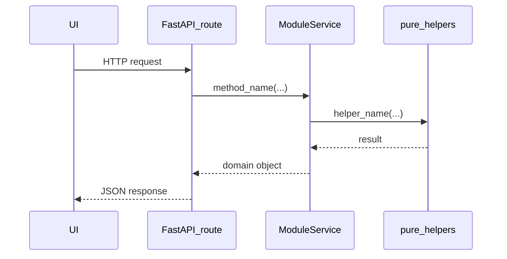
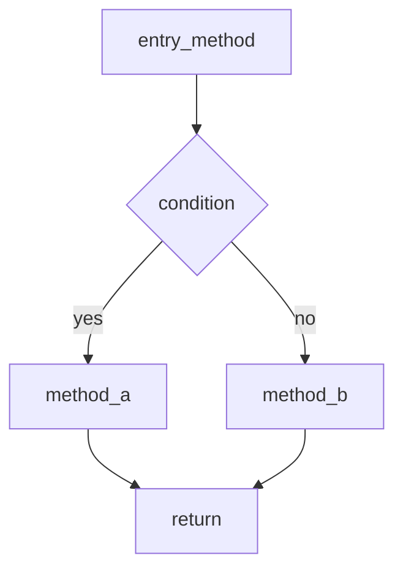

# Module Documentation Generation Guide

**Purpose:** Use this file as the process controller when creating or updating individual module Markdown docs and flow diagrams for VeriDemand.

**Canonical product/tech source of truth:** [`../prototype_documentation.md`](../prototype_documentation.md) (v0.2+)

**Output directory:** [`docs/modules/`](./) (this folder)

---

## How to use this file (agent / human)

When the user asks to create or update a module doc, follow this process exactly:

1. Read [`../prototype_documentation.md`](../prototype_documentation.md) for the module’s FR-*, exit gate, related architecture, API, and roadmap phase.
2. Identify the target module from the [Module build order](#module-build-order) table below.
3. Create or overwrite `docs/modules/<NN>-<slug>.md` using the [Required document template](#required-document-template).
4. Derive **proposed** classes, methods, and functions from FR-* and §14.5 service interfaces. Label them as **proposed design** until code exists; when code exists, align names to the real implementation.
5. Include **at least three** Mermaid diagrams (see [Diagram requirements](#diagram-requirements)).
6. Cross-link dependencies (upstream / downstream modules).
7. Do **not** invent paid DocAI, LLM-first extraction, or permanent DB unless the user explicitly changes the prototype doctrine.
8. Do **not** redefine entity field shapes in module docs — use [`docs/contracts/`](../contracts/README.md) as the contracts SoT. **If module prose conflicts with contracts, contracts win.**
9. Include a metadata table row `Contracts` linking the owning entity/enum/taxonomy files for that module.
10. Do **not** edit [`../prototype_documentation.md`](../prototype_documentation.md) unless the user asks to change the product spec.
11. After writing, update the status row in [Module build order](#module-build-order) and [`README.md`](./README.md).

---

## Living artifacts

Module docs describe behavior and flows. These folders hold durable detail that modules must **link to**, not duplicate:

| Artifact | Path | Used when |
|----------|------|-----------|
| Field contracts, enums, taxonomies | [`docs/contracts/`](../contracts/README.md) | Any entity / API payload shape |
| Preflight / export DTOs | [`preflight-report.md`](../contracts/entities/preflight-report.md), [`export-result.md`](../contracts/entities/export-result.md) | Module 10 |
| Gold answer keys (**shape**) | [`docs/example/gold/`](../example/gold/README.md) | Phase 5+ acceptance shape; **`docs/example/` is illustrative only** |
| Evaluation runner / metrics | [`docs/modules/12-evaluation-demonstration.md`](./12-evaluation-demonstration.md) | Phase 10 harness, metrics, blind packet, demo script |
| OCR thresholds | [`docs/modules/03-ocr-thresholds.md`](./03-ocr-thresholds.md) | Phase 3 routing/confidence knobs (`0.1-provisional`) |
| Parser catalog | [`docs/modules/05-fact-parser-catalog.md`](./05-fact-parser-catalog.md) | Phase 5 DET parsers (`0.1-provisional`) |
| API error codes | [`docs/contracts/error-codes.md`](../contracts/error-codes.md) | HTTP/API `error_code` + messages |
| Light UI notes | [`docs/modules/ui-notes.md`](./ui-notes.md) | Panel/recovery UX contract (not wireframes) |

**Addenda** (`03-ocr-thresholds`, `05-fact-parser-catalog`, `ui-notes`) are living artifacts: they do **not** require the full numbered-module template below.

When regenerating a module doc, pull field names and enums from `docs/contracts/` instead of inventing new shapes. Treat `docs/example/` as sample evaluation material, not product scope.

### Prompt snippet (copy into a new chat)

```text
Using docs/modules/MODULE_DOC_GENERATION.md as the process controller,
generate the next incomplete module document in build order.
Follow the required template and diagram rules.
Source of truth: docs/prototype_documentation.md
Field contracts: docs/contracts/ (do not fork shapes; use Fact + FactStatus, not a separate FactCandidate type)
```

Or for a specific module:

```text
Using docs/modules/MODULE_DOC_GENERATION.md, create/update
docs/modules/05-deterministic-fact-extraction.md
from docs/prototype_documentation.md (v0.2 extraction policy).
```

---

## Module build order

Build and document in this order. Do not skip exit-gate dependencies.

**Important:** **Module N ≠ Phase N.** Canonical Phase ↔ Module ↔ UI map: [`README.md`](./README.md#phase--module--ui-crosswalk).

| NN | File | Spec sections | Roadmap phase | Status |
|----|------|---------------|---------------|--------|
| 00 | `00-repository-and-contracts.md` | §6–7, §14, Phase 0 | Phase 0 | design |
| 01 | `01-session-and-workspace.md` | §8.1, Phase 1 | Phase 1 | design |
| 02 | `02-upload-validation-normalization.md` | §8.2, Phase 1 | Phase 1 | design |
| 03 | `03-page-analysis-and-text-extraction.md` | §8.3, §9, Phases 2–3 | Phases 2–3 | design |
| 04 | `04-document-classification-and-sequencing.md` | §8.4, Phase 4 | Phase 4 | design |
| 05 | `05-deterministic-fact-extraction.md` | §8.5, Phase 5 | Phase 5 (extraction MVP) | design |
| 06 | `06-chronology-and-billing.md` | §8.7, Phase 6 | Phase 6 | design |
| 07 | `07-issue-and-contradiction-engine.md` | §8.8, Phase 7 | Phase 7 | design |
| 08 | `08-human-review-and-manual-intervention.md` | §8.9, §11, Phase 7 | Phase 7 | design |
| 09 | `09-demand-generation.md` | §8.10, §12, Phase 8 | Phase 8 | design |
| 10 | `10-verification-preflight-and-export.md` | §8.11, §12, Phase 9 | Phase 9 | design |
| 11 | `11-llm-semantic-consolidation-optional.md` | §8.6, §10, Phase 6 optional | Deferred / optional | deferred / design |
| 12 | `12-evaluation-demonstration.md` | §17, §18 Phase 10 | Phase 10 | design |

**Deferred by doctrine:** Module `11` is optional. Do not treat it as required for the extraction MVP. Module `12` owns Phase 10 evaluation; gold **shape** remains under `docs/example/gold/`.

---

## Non-negotiable doctrine (carry into every module doc)

- Evidence before prose; LLM is **not** the primary extractor.
- Critical fields: correct **or** explicitly Amber/Red — never silently wrong.
- Deterministic for IDs, dates, money, counts, exact conflicts.
- Free/open OCR stack (PaddleOCR + pypdfium2 load-bearing); no paid document-AI.
- Session-only persistence for the prototype.
- Existing demand DOCX is not authoritative evidence unless user enables FR-CLS-06.
- Reference corpus: `docs/example/` (Amini gold path).

---

## Required document template

Every module file MUST use these sections in order:

```markdown
# NN. Module Name

| Field | Value |
|-------|-------|
| Spec | §X.Y / Phase N |
| Service(s) | e.g. SessionService |
| Upstream | modules this depends on |
| Downstream | modules that consume this |
| Exit gate | quote/paraphrase from prototype |
| Status | design / implementing / done |
| Contracts | links to docs/contracts entities/enums/taxonomies this module owns or primarily mutates |

## 1. Purpose
What this module is for (1 short paragraph).

## 2. Responsibilities
Bullet list of what it owns / does not own.

## 3. Inputs and outputs
Tables of inputs, outputs, side effects (temp files, events).

## 4. Functional requirements
Copy FR-* IDs from the prototype; add acceptance notes per FR.

## 5. Proposed design (classes, methods, functions)
### 5.1 Types / models
Name types and point to `docs/contracts/` for field shapes. Do not paste full BaseModel/Enum value lists that fork contracts.
### 5.2 Service API (method list with signatures)
### 5.3 Helpers / pure functions
### 5.4 API endpoints (if any)
Mark all as **proposed** until implemented.

## 6. Detailed flows
### 6.1 Context diagram (Mermaid)
### 6.2 End-to-end sequence (Mermaid sequenceDiagram)
### 6.3 Internal algorithm (Mermaid flowchart) down to method calls
### 6.4 Error / edge-case flow (Mermaid)

## 7. Data contracts
**Contracts SoT:** link `docs/contracts/`. State conflict rule: if prose conflicts with contracts, contracts win.
Table of entity/enum/taxonomy links. Optional illustrative JSON labeled “fields from contracts” only.

## 8. UI touchpoints
Screens/panels affected (or "backend only").

## 9. Testing and exit gate
Unit/integration/golden checks; how to know the module is done.

## 10. Open questions / non-goals
Explicitly list what this module must not do.
```

---

## Diagram requirements

Use Mermaid only (renders in GitHub and many Markdown viewers).

### Rules

1. **No spaces in node IDs** — use camelCase (`createSession`, not `Create Session`).
2. Labels with special characters → wrap in quotes: `A -->|"O(1) lookup"| B`.
3. Prefer `flowchart TD` / `LR` and `sequenceDiagram`.
4. Sequence diagrams MUST name **actors** (UI, API route, Service, Helper) and **messages** that match proposed method names (e.g. `SessionService.create_session()`).
5. Flowcharts MUST show decision branches that map to FR-* behavior (e.g. native vs OCR).
6. Include at least one diagram that drills to **helper function** level (e.g. `hash_file_sha256`, `score_native_text_usability`).

### Sequence pattern



### Flowchart pattern



---

## Naming conventions (proposed code)

| Layer | Convention | Example |
|-------|------------|---------|
| Backend service class | `PascalCase` + `Service` | `ExtractionService` |
| Public service methods | `snake_case` | `extract_document_pages` |
| Pure helpers | `snake_case` verbs | `normalize_date`, `score_native_text_usability` |
| Pydantic models | `PascalCase` | `SourceSpan`, `Fact` (use `FactStatus` for lifecycle; do not add a separate `FactCandidate` type) |
| API routes | `/api/v1/...` from prototype §14.2 | `POST /api/v1/sessions` |
| Frontend feature folder | match prototype Appendix C | `features/facts/` |
| Events | `domain.object.action` | `document.page.processed` |

---

## Depth rules for “methods and functions”

For each public service method, document:

- **Name + signature** (args, return type)
- **Called by** (route, job stage, or other service)
- **Calls** (helpers / other services)
- **FR mapping** (which FR-* it satisfies)
- **Failure modes** (errors, warnings, review items)

Do not invent distributed queues, DBs, or auth unless the prototype adds them.

---

## Quality checklist (before marking Status = done)

- [ ] All FR-* for that module listed with acceptance notes
- [ ] Exit gate stated and testable
- [ ] Upstream/downstream links correct
- [ ] ≥3 Mermaid diagrams; method names appear in at least one sequence diagram
- [ ] Extraction-related modules respect “no LLM-primary-extractor”
- [ ] Temp files / cleanup mentioned if the module touches disk
- [ ] Reference to `docs/example/` where relevant for golden tests
- [ ] Metadata table includes `Contracts` row with links to owning `docs/contracts/` files
- [ ] §7 states SoT + conflict rule (contracts win) and links entities/enums (no forked BaseModel field tables)
- [ ] Entity fields reference `docs/contracts/` (no forked shapes); use `Fact` not a separate `FactCandidate` type
- [ ] Status updated in this guide’s table and in `README.md`

---

## Relationship to other docs

| Doc | Role |
|-----|------|
| `docs/prototype_documentation.md` | Product + architecture SoT — do not fork doctrine here |
| `docs/contracts/` | **Field-level contracts SoT** — entities, enums, taxonomies, error codes, preflight/export |
| `docs/modules/MODULE_DOC_GENERATION.md` | **This file** — process controller for module docs |
| `docs/modules/NN-*.md` | Per-module design + flows (behavior SoT; link contracts) |
| `docs/modules/README.md` | Index, module→contracts map, progress |
| `docs/example/` | Golden corpus **shape** for acceptance |
| `docs/modules/12-evaluation-demonstration.md` | Phase 10 evaluation runner / metrics |

---

## Changelog

| Date | Change |
|------|--------|
| 2026-07-18 | Initial generation guide created for v0.2 prototype doctrine |
| 2026-07-18 | Initial suite of module docs `00`–`11` generated; statuses set to `design` |
| 2026-07-18 | Living artifacts: link `docs/contracts/` as contracts SoT |
| 2026-07-18 | Living artifacts: illustrative gold pack at `docs/example/gold/` |
| 2026-07-18 | Living artifacts: OCR thresholds at `docs/modules/03-ocr-thresholds.md` |
| 2026-07-18 | Living artifacts: fact parser catalog at `docs/modules/05-fact-parser-catalog.md` |
| 2026-07-18 | Living artifacts: error-codes + ui-notes (Pass 5) |
| 2026-07-19 | SoT backfill: template Contracts row + §7 conflict rule; Fact naming; preflight/export contracts |
| 2026-07-19 | Module 12 evaluation; Phase≠Module note; gold shape vs runner split; addenda template exception |
